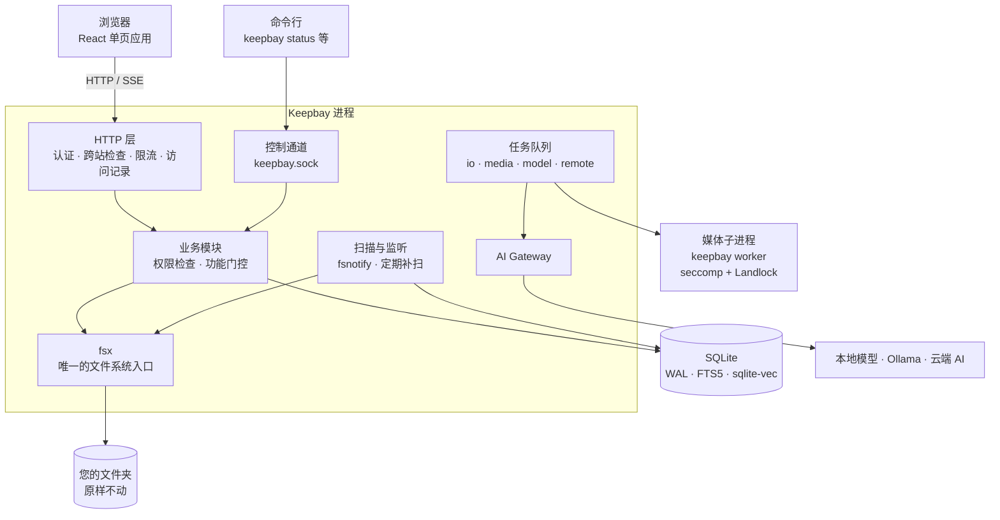
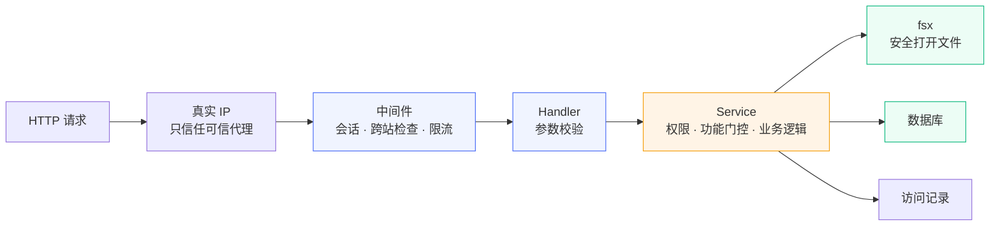
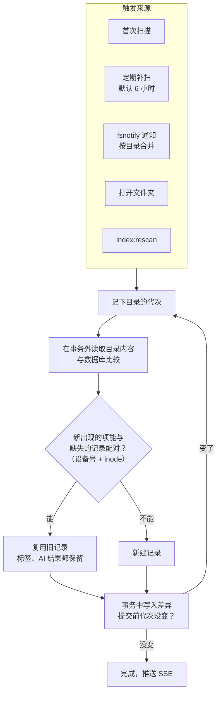
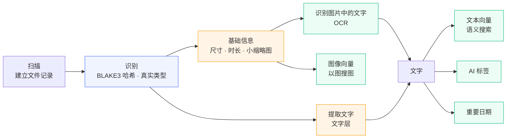
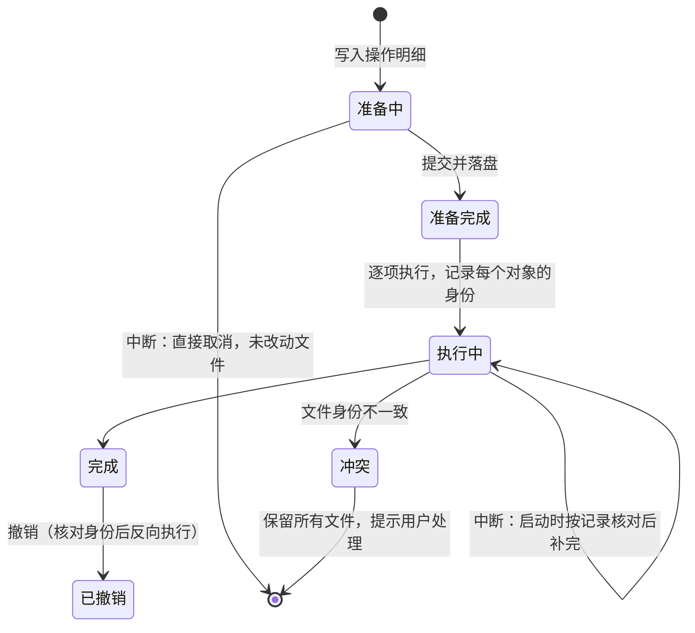
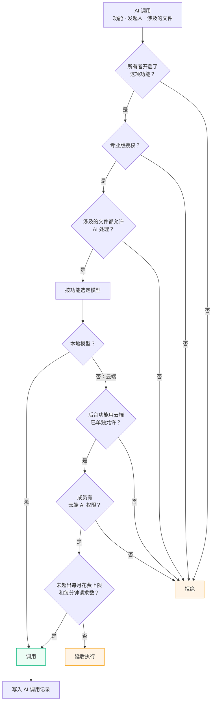
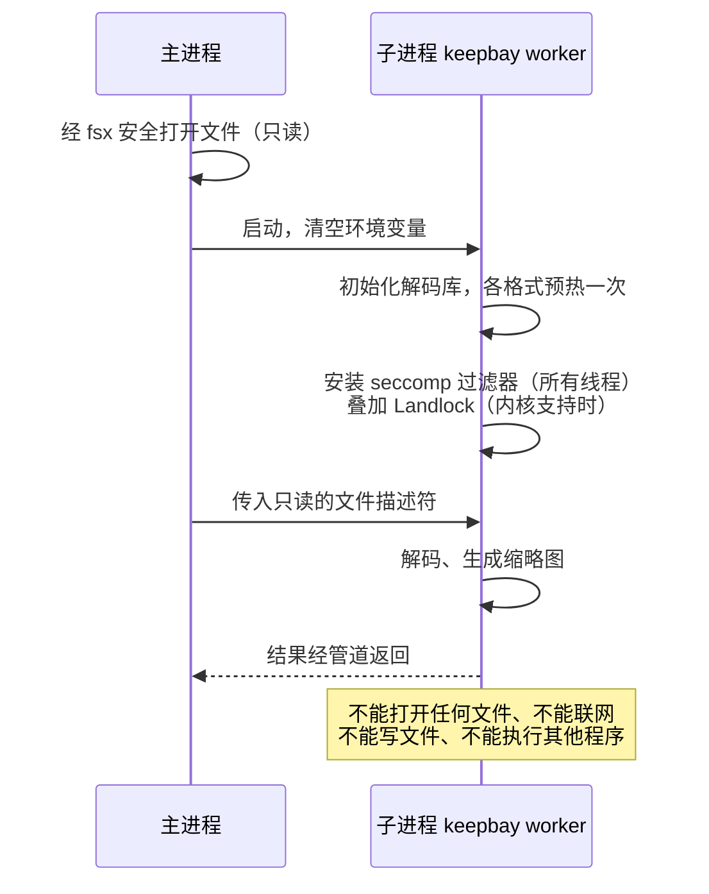
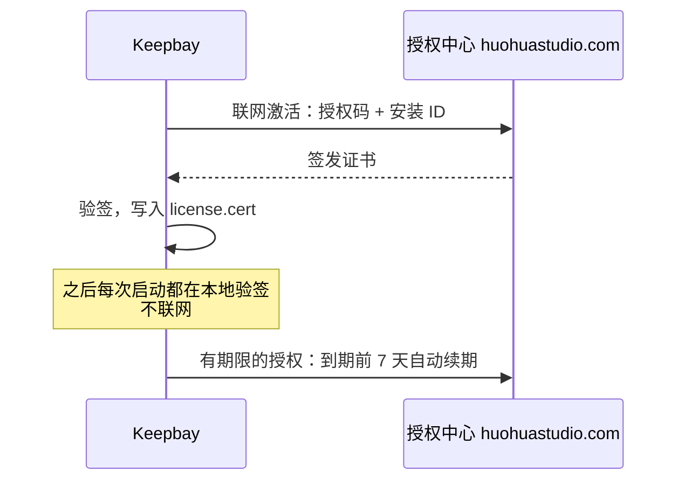

# 技术架构 {#architecture}

本页说明 Keepbay 的内部工作方式：进程和数据如何组织、一个请求经过哪些检查、文件夹如何扫描和建立索引、文件操作如何避免丢失文件、AI 调用受哪些限制。

日常使用不需要了解这些，排查问题或评估是否适合您的环境时可以参考。

## 总体结构 {#overview}

一个进程、一个数据目录、一个 SQLite 数据库。前端页面编译在程序里，不需要另外部署 Web 服务器或数据库。

代码遵循以下几条原则。

所有文件访问都经过 fsx 这一个模块。其他代码无法获取原始路径，不能绕过路径校验和只读限制。

所有 AI 调用都经过 AI Gateway。其他代码无法直接访问模型，不能绕过功能开关、授权和花费上限。

接口和网址中只使用 ID，不使用路径，路径只在服务端使用。这样也避免了一个问题：非 UTF-8 的文件名（比如旧版 Windows 生成的 GBK 文件名）无法在 JSON 和网址中原样表示。

另外，Keepbay 只有一个进程，数据目录加了锁，同一时间只有它打开数据库。因此不需要分布式系统中的任务租约、心跳等机制，代码也简单很多。

### 技术栈 {#stack}

| 部分 | 使用 |
|---|---|
| 后端 | Go，HTTP 框架 Huma（同时生成 OpenAPI 描述） |
| 数据库 | SQLite（mattn/go-sqlite3），迁移用 goose，查询代码由 sqlc 生成 |
| 搜索 | SQLite FTS5（文件名、全文），sqlite-vec（向量） |
| 前端 | React、TanStack Router、TanStack Query、Zustand、Tailwind CSS、Base UI |
| 图片 | libvips（带 libraw、librsvg），在受限子进程中运行 |
| 视频、HEIC | 系统中的 ffmpeg（不随程序附带），同样在受限环境中运行 |
| PDF | PDFium 的 WebAssembly 版本，在内存安全的沙箱中运行 |
| 本地 AI | ONNX Runtime |
| 云端 AI | 按 OpenAI 兼容接口调用 |
| 哈希 | BLAKE3 |

## 请求的处理 {#request}

网页上的每个操作都是对 `/api/v1` 的一次请求，经过以下几层：

权限检查放在 Service 层，而不是网页请求的入口。

后台任务、操作恢复、撤销调用的也是同一个 Service，所以它们执行时会重新检查权限。如果成员提交了一个复制任务，执行前权限被收回，这个任务就不会执行。

成员请求无权访问的文件或标签时，得到的响应与"不存在"完全相同，无法通过错误信息的差异来探测。

专业版功能的检查（功能门控）在三处各做一次：接口调用、AI Gateway、后台任务执行时。前端只根据结果显示或隐藏入口，不作为判断依据，修改前端代码无法解锁任何功能。

网页上的实时变化通过 `/api/v1/events` 的 SSE 推送：任务进度、文件夹变化、通知。

事件只通知前端需要刷新，并带有递增的序号。前端发现断线或序号不连续时，会重新获取当前页面的状态，不会遗漏变化。

每 25 秒发送一次心跳，经过反向代理时也不会因长时间没有数据而被断开。

## 数据库 {#database}

SQLite 用 WAL 模式，读写互不阻塞。读连接池的大小取 CPU 核数，至少 4 个。

写连接只有一个，并且用 `synchronous=FULL`：文件操作的记录必须在改动文件之前写入磁盘，断电也不会丢失。代价是每次提交多一次刷盘，我们通过批量提交来降低这部分开销。

扫描、索引这类后台写入每批约 500 行，批次之间释放写连接。这样即使十万个文件的首次扫描正在后台写入，您在网页上改名等操作也不需要等它完成。

文件记录只存父目录的 ID 和自己的名字，不存完整路径。这样在同一个文件夹里改名或移动一个目录只需要改一行，不用把它下面成千上万个文件的路径都改一遍。

API Key、两步验证密钥、通知渠道和代理的密码用数据目录中的 `secret.key` 加密（AES-GCM）后存储，见[隐私与安全](./privacy#encryption)。

## 扫描与索引 {#scan}

Keepbay 以文件夹为准：文件原样留在磁盘上，数据库只是索引。所有变化最终都调用同一个函数——**核对一个目录**：

本地磁盘用 fsnotify（Linux 上是 inotify）监听，每个目录一个监听。

通知按目录合并：目录 3 秒内没有新的变化后核对；有程序在持续写入大文件时，最多 30 秒也会核对一次。

inotify 的监听数量有上限（`fs.inotify.max_user_watches`），达到上限后，其余目录依靠定期补扫，见[常见问题](./faq#inotify)。

SMB、NFS 等网络磁盘无法接收通知，同样依靠定期补扫，间隔可以按文件夹设置。

在 Keepbay 之外改名、移动的文件，只要仍在同一个添加的文件夹、同一块磁盘中，会按设备号和 inode 与原来的记录配对，沿用原来的 ID，已有的标签和 AI 结果都会保留。

这是"以文件夹为准"必须解决的问题，否则在访达中移动文件夹后，之前的处理结果就会丢失。

判断文件已不存在需要格外谨慎。只有完整读取成功的目录才能得出这个结论，读取出错、权限不足、中途中断的情况都不能作为依据。

缺失的记录先保留 30 天。如果一次扫描发现超过 20% 的文件缺失，Keepbay 会暂停清理，等待所有者确认，因为这种情况更可能是硬盘没有挂载，而不是五分之一的文件被删除。

出于同样的原因，文件夹和其中嵌套的每块磁盘都会单独检查：是否存在、设备号是否变化、是否突然变为空。

任何一项异常时，就标记为离线，停止核对和清理，并拒绝写入。否则上传的文件会写入挂载点下的空目录，硬盘重新挂载后，这些文件会被遮挡而无法访问。

NAS 和操作系统的杂项（`@eaDir`、`#recycle`、`#snapshot`、`.DS_Store`、`Thumbs.db`、`$RECYCLE.BIN`、`lost+found` 等）始终跳过。

开发目录（`node_modules`、`.git` 等）、照片图库、其他应用的资料库、同步软件的缓存默认也跳过，避免搜索结果中出现大量无关的小文件。这几类可以在设置中打开。

## 内容处理流水线 {#pipeline}

文件建立记录后，按内容（哈希相同的文件共用一份内容）逐步处理：

哈希用 BLAKE3。64 MiB 以内的文件直接算完整哈希。

更大的文件先算抽样哈希（文件大小加上头、中、尾各 64 KiB），只有遇到大小和抽样哈希都相同的文件时，才补算完整哈希。这样无需为了确认一部 50 GB 的电影是否重复而完整读取整个文件。

识别时完整哈希相同的文件算同一份内容，共用缩略图、文字和 AI 结果。超过 64 MiB 的大文件各自处理，补算的完整哈希只用来找出重复的文件。

缩略图是 WebP。网格里用的小图短边 256px、长边最多 768px，扫描时生成；预览用的大图长边 2048px，第一次打开时才生成。它们按内容存放在数据目录的 `thumbs/` 中。

文字来自纯文本、Office 文档（docx、xlsx、pptx）和 PDF 的文字层，单个文件最多取 1 MiB，PDF 最多 2000 页。图片中的文字通过 OCR 识别；没有文字层的扫描版 PDF 目前不做 OCR。

缺少依赖（比如未安装 ffmpeg、未下载本地模型）时，对应的步骤记为跳过，依赖就绪后自动补做。

处理程序升级或更换模型后，只重新执行受影响的步骤，不会重新执行整个流水线。

图中绿色的步骤用到 AI 模型，属于专业版功能，数据去向见[隐私与安全](./privacy#ai)。

## 任务队列 {#jobs}

扫描以外的处理都放进任务队列，存在数据库中，重启后继续。

| 资源类别 | 默认并发 | 做什么 |
|---|---|---|
| io | 4 | 扫描、识别、哈希、复制 |
| media | 2 | 缩略图、提取文字（子进程） |
| model | 1 | 本地模型推理：OCR、向量、AI 标签、日期提取 |
| remote | 4 | 下载模型、离线下载、发送通知 |

失败的任务 30 秒后重试，之后每次等待时间加倍（带少量随机抖动），最长 6 小时，默认最多 5 次。

云端 AI 被限流、超出了花费上限、还没有专业版授权，都不算失败，只会延后执行。因授权不足而等待的任务显示为"等待专业版授权"，激活专业版后自动继续。

同一个文件连续修改多次时，排队中的任务会更新为最新的输入，只处理最后一次。

任务执行时会记录输入的版本（内容、处理程序版本、模型），写入结果前进行核对。如果处理期间文件被改写或模型被更换，这次的结果会被丢弃，避免旧的结果覆盖新文件的结果。

进度按任务组和阶段计数，显示在侧栏的「后台任务」中，也可以用 `keepbay index:status` 查看。

## 文件操作 {#file-ops}

移动、复制、删除、改名都记录在操作记录中，**先落盘记录、再改动文件**，中途断电或崩溃都不会丢失文件：

Keepbay 从不覆盖文件。

支持 `renameat2(RENAME_NOREPLACE)` 的文件系统（ext4、btrfs、xfs 等）直接用它。不支持的（比如 NFS）用硬链接或占位目录来实现同样的效果，整个过程不会按您看到的文件名删除任何内容。

恢复和撤销时，Keepbay 按记录下来的设备号、inode、大小、修改时间核对文件是否为原来的文件，而不只是检查路径是否存在。

如果原来的位置上出现了一个同名的新文件，它不会被当作"待清理的旧文件"删除。核对不一致时一律保留所有文件，将操作标记为冲突，由您处理。

跨磁盘移动时，先复制到目标位置的临时文件。全部复制成功，且源文件在此期间没有被修改，才把源文件移入回收站。

如果复制过程中断电，源文件仍然完整，未复制完的临时文件在下次启动恢复时重新处理。

回收站在文件夹根目录的 `.keepbay-trash/` 中（文件夹中嵌套了其他磁盘时，那块磁盘有自己的回收站）。它与文件位于同一块磁盘上，删除只是一次改名操作，文件夹再大也能很快完成，默认保留 30 天。远程文件夹的回收站在存储上，对象存储没有改名，删除是在后台复制再删除。

编辑保存、上传时选择替换，也是先写临时文件，替换前再次核对旧文件没有被其他程序修改，旧文件移入回收站。

## AI 调用 {#ai-gateway}

所有 AI 调用都经过 AI Gateway，按顺序检查，任何一项不通过都不会发出请求：

模型属于本地还是云端由接口地址判断，不提供手动选择。

回环地址、局域网地址、不带点的主机名、`.local` 等后缀视为本地，比如本机或局域网中的 Ollama；其余都视为云端，必须使用 HTTPS。

本地模型目前有三个，通过 ONNX Runtime 运行：

- bge-small-zh-v1.5：文本向量
- Chinese-CLIP ViT-B/16：图像向量
- PP-OCRv5 mobile：文字识别

模型清单用 ed25519 签名，下载后核对 SHA256。

云端厂商预设了 OpenAI、DeepSeek、通义千问、豆包、Kimi、智谱、硅基流动、OpenRouter、Gemini、Ollama，也可以自定义，全部按 OpenAI 兼容接口调用。

每次实际发出的调用都记在调用记录中，不保存内容本身，见[隐私与安全](./privacy#ai)。

## 媒体处理的隔离 {#sandbox}

libvips、libraw 等解码库用 C 编写，恶意构造的图片可能触发内存错误。

只限制资源不够，被利用的解码器仍能读写文件、读取密钥、联网。因此解码在受限的子进程中进行：

seccomp 过滤器禁止打开文件、建立网络连接、删除、改名、修改权限、执行其他程序、调试其他进程。内核 7.0 及以上再叠加 Landlock，作为第二层。

子进程的地址空间上限 4 GiB，不能写普通文件。每个任务 2 分钟超时，处理 500 个任务后换一个新的子进程。子进程崩溃只会让这一个文件处理失败。

ffmpeg 是外部程序，启动时需要加载自己的动态库，无法禁止它打开文件。因此我们为它加载一个限制较宽的过滤器：只能以只读方式打开文件，不能写入、联网、创建进程，输入通过标准输入传入。

PDF 则用 PDFium 的 WebAssembly 版本在主进程里解析，不挂载任何宿主目录，每个实例最多 256 MiB 内存。

内核不支持 seccomp 时，Keepbay 默认不在没有隔离的情况下解码照片和视频。浏览器能直接显示的图片和视频不经过解码，仍然可以预览，见[安装](./install#nas)。所有者也可以选择照样处理，见[隐私与安全](./privacy#sandbox)。

这是纵深防御，用来大幅提高利用的难度，不承诺绝对隔离。

## 授权验证 {#license}

专业版的授权证书是 `base64url(内容).base64url(ed25519 签名)`，公钥编译在程序中，**验证在本地离线完成**：

激活后验证在本地完成，无法联网的设备可以直接导入证书文件。安装 ID 是什么、什么时候会联网续期，见[隐私与安全](./privacy#outbound)。

有期限的授权到期后有 7 天宽限期，之后降级为免费版。

已有的标签、提醒、向量都保留，重新激活后立即可用，您的文件不受任何影响。
