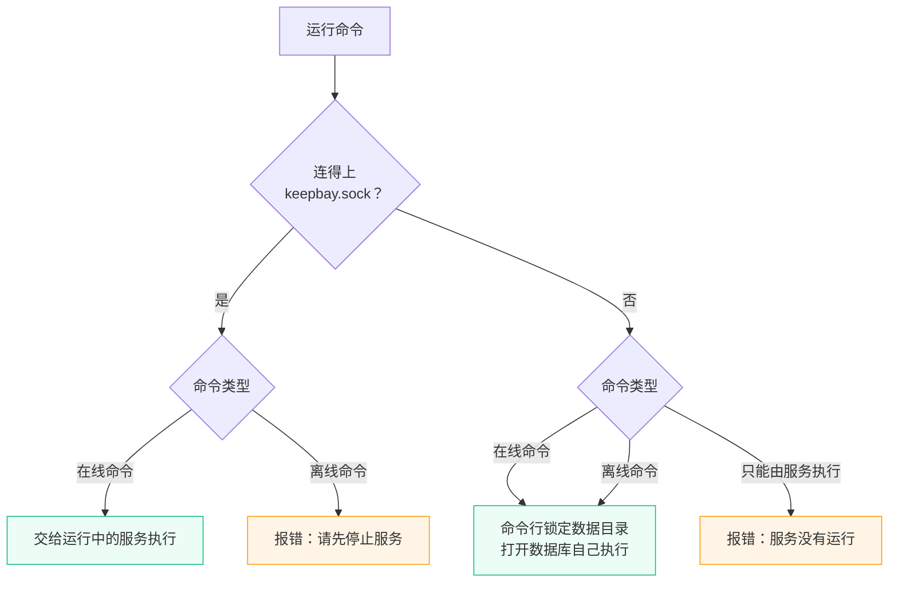

# 命令行 {#cli}

Keepbay 程序自带一套管理命令。首次设置、装系统服务、看状态、查环境、更新、重设密码、备份和恢复数据库、重新扫描文件夹，都能在终端里完成。最常用的场景是网页进不去了：密码忘了、两步验证的手机丢了、被锁在门外，这时候命令行就是备用钥匙。

## 基本用法 {#usage}

```bash
keepbay                        # 按分组列出全部命令
keepbay help <命令>            # 查看命令的详细用法，同 keepbay <命令> --help
keepbay <命令> [选项] [参数]
```

下文的 `keepbay` 指安装目录中的程序。按[安装](./install)中的布局，命令要以运行服务的用户执行：

```bash
sudo -u keepbay /opt/keepbay/keepbay status
```

建议都用这个用户运行。服务在运行时，root 也能通过控制通道执行在线命令；但服务没运行、命令要自己打开数据库，而数据目录又属于别的用户时，root 会被拒绝：命令新建的文件会属于 root，之后服务自己反而读写不了，所以 Keepbay 会提示您换成数据目录所属的用户。安装、卸载系统级服务（`setup` 最后一步、`service:install`、`service:uninstall`）要以 root 运行；用普通用户运行时装的是这个用户自己的服务。

### 通用选项 {#common-options}

| 选项 | 说明 |
|---|---|
| `-h`、`--help` | 显示命令的用法 |
| `-n`、`--no-interaction` | 不弹出交互：缺参数时直接报错 |
| `--data-dir 目录` | 数据目录，也可以用环境变量 `KEEPBAY_DATA_DIR`；不写时 Linux 用 `/var/lib/keepbay` |

### 交互和退出码 {#interaction}

只有输入和输出都是终端、并且没有加 `-n` 时，缺少的参数才会在终端里弹出选择或输入框；在脚本中运行时缺参数直接报错，并显示该命令的用法。会改动数据的命令（如 `user:reset-password`、`db:restore`）在终端里先确认，加 `--force` 跳过确认。

| 退出码 | 含义 |
|---|---|
| `0` | 成功 |
| `1` | 执行失败，原因输出到标准错误 |
| `2` | 用法错误：没有这个命令、缺参数、选项不对 |
| `130` | 按 Ctrl+C 中断，或在确认时取消 |

## 在线命令和离线命令 {#online-offline}

数据库同一时间只能由一个进程写入，命令行不能趁服务运行时自己去改数据库。所以命令行先试着连数据目录中的控制通道 `keepbay.sock`，连上了就请服务代劳，连不上再自己动手。按命令的性质分三类：



| 类型 | 命令 |
|---|---|
| 在线命令：服务在运行时由服务执行，没运行时命令行自己执行 | `status`、`doctor`、`user:list`、`user:unlock`、`user:2fa-off`、`db:backup`、`db:check`、`mount:list`、`index:status`、`update:check` |
| 离线命令：要独占数据库，必须先停止服务 | `user:reset-password`、`db:restore`、`db:vacuum` |
| 只能由运行中的服务执行 | `index:rescan`、`setup:token`、`update` |

控制通道的权限是 `0600`，服务只接受同一用户或 root 的连接。数据目录的路径太长时（系统对 socket 路径的长度有限制）不创建控制通道，这时在线命令要先停止服务再运行。

## 命令一览 {#commands}

**安装与服务**

| 命令 | 说明 |
|---|---|
| `setup` | 在终端里完成首次设置：数据目录、端口、所有者帐号，可安装为系统服务 |
| `setup:token` | 显示首次设置的令牌（还没有完成设置时） |
| `service:install` | 安装为系统服务，开机自动启动 |
| `service:uninstall` | 卸载系统服务，数据目录不删除 |
| `status` | 查看服务是否在运行、地址、版本、数据库和备份 |
| `doctor` | 检查依赖、沙箱、目录权限和端口 |
| `update:check` | 检查有没有新版本 |
| `update` | 更新到新版本 |
| `serve` | 启动服务（由系统服务调用，一般不需要手动运行） |
| `version` | 显示版本 |

**帐号**

| 命令 | 说明 |
|---|---|
| `user:list` | 列出全部用户：用户名、名称、身份、两步验证、状态 |
| `user:reset-password` | 忘记密码时重设（需要先停止服务） |
| `user:unlock` | 解除登录锁定 |
| `user:2fa-off` | 关闭两步验证 |

**数据库**

| 命令 | 说明 |
|---|---|
| `db:backup` | 立即备份数据库 |
| `db:restore` | 用备份恢复数据库（需要先停止服务） |
| `db:check` | 完整检查数据库 |
| `db:vacuum` | 压缩数据库（需要先停止服务） |

**索引与文件夹**

| 命令 | 说明 |
|---|---|
| `mount:list` | 列出文件夹、在线状态和文件数 |
| `index:rescan` | 重新扫描文件夹 |
| `index:status` | 查看后台任务各阶段的进度 |

## 启动参数 {#serve}

`keepbay serve` 启动服务。启动参数只有启动前必须知道的几项，其余设置都存在数据库中，在网页上修改。

| 选项 | 环境变量 | 默认值 | 说明 |
|---|---|---|---|
| `--listen` | `KEEPBAY_LISTEN` | `0.0.0.0:8899` | 监听地址 |
| `--data-dir` | `KEEPBAY_DATA_DIR` | `/var/lib/keepbay` | 数据目录 |
| `--trusted-proxies` | `KEEPBAY_TRUSTED_PROXIES` | 空 | 可信反向代理的 IP 或网段，逗号分隔，见[外网访问](./remote-access#trusted-proxies) |
| `--base-path` | `KEEPBAY_BASE_PATH` | `/` | 部署的子路径，如 `/keepbay/`，见[外网访问](./remote-access#base-path) |
| `--log-level` | `KEEPBAY_LOG_LEVEL` | `info` | 日志级别：`debug`、`info`、`warn`、`error` |

优先级：命令行参数 > 环境变量 > 默认值。另有 `--license-server`、`--model-manifest` 两项（授权中心和远程模型清单的地址），一般不需要设置。

装成系统服务后，监听地址和数据目录写在服务文件的启动命令中；其他参数建议用环境变量追加，升级时不会被覆盖：

```bash
sudo systemctl edit keepbay
```

```ini
[Service]
Environment=KEEPBAY_TRUSTED_PROXIES=127.0.0.1,::1
Environment=KEEPBAY_LOG_LEVEL=debug
```

```bash
sudo systemctl restart keepbay
```

日志同时写到数据目录的 `logs/keepbay.log` 和标准错误（systemd 下用 `journalctl -u keepbay` 查看），单个文件 5 MB 后换新文件，保留 3 个旧文件；程序崩溃的信息另外写到 `logs/crash.log`。

## 安装与服务 {#setup-commands}

### setup {#setup}

代替浏览器中的设置向导：选择数据目录和端口、创建所有者帐号，最后可以安装为系统服务。服务已经在运行时只创建所有者帐号。

```bash
# 以 root 运行，服务以 keepbay 用户运行
sudo /opt/keepbay/keepbay setup --user keepbay

# 在脚本中运行：用户名和密码都要写明
echo "$PASSWORD" | sudo /opt/keepbay/keepbay setup --username admin --password-stdin --service --user keepbay
```

| 选项 | 说明 |
|---|---|
| `--listen 地址` | 服务的监听地址，默认 `0.0.0.0:8899` |
| `--username 用户名` | 所有者的用户名：字母、数字和 `.` `_` `-` |
| `--display-name 名称` | 显示在网页上的名称，默认同用户名 |
| `--password-stdin` | 从标准输入读取所有者的密码（一行） |
| `--service` | 设置完成后安装为系统服务 |
| `--user 用户` | 以 root 运行时，指定运行服务的系统用户 |

各步骤的说明见[首次设置](./setup#terminal)。

### setup:token {#setup-token}

显示设置向导的令牌。令牌在服务启动时生成，只保存在服务的内存中，所以服务要在运行。已经完成设置时输出"已经完成首次设置"。

### service:install {#service-install}

安装为系统服务并立即启动。Linux 用 systemd，macOS 用 launchd。以 root 运行时安装为系统级服务（开机即启动，以 `--user` 指定的用户运行），否则安装为当前用户的服务。

| 选项 | 说明 |
|---|---|
| `--user 用户` | 以哪个系统用户运行服务；以 `sudo` 运行时默认是运行 `sudo` 的用户 |
| `--listen 地址` | 服务的监听地址，默认 `0.0.0.0:8899` |
| `--force` | 已经安装过时直接覆盖并重启服务，不再确认 |

以 root 安装系统级服务时，会把数据目录交给运行服务的用户（数据目录不能是符号链接，上级目录要让这个用户能进入）。生成的 systemd 服务文件在 `/etc/systemd/system/keepbay.service`：

```ini
[Unit]
Description=Keepbay
After=network-online.target
Wants=network-online.target

[Service]
Type=simple
User=keepbay
Group=keepbay
ExecStart=/opt/keepbay/keepbay serve --data-dir /var/lib/keepbay --listen 0.0.0.0:8899
Restart=on-failure
RestartSec=5
NoNewPrivileges=true
PrivateTmp=true
ProtectKernelTunables=true
ProtectKernelModules=true
ProtectControlGroups=true
RestrictSUIDSGID=true
LockPersonality=true
LimitNOFILE=65536

[Install]
WantedBy=multi-user.target
```

您可能会问为什么没有 `ProtectHome`、`ProtectSystem=strict`：您的文件夹可能在 `/home`、`/mnt`、`/media` 等任何地方，加了这两项，服务就读不到它们了，网盘看不到文件可不行。

不能安装的情况：系统没有使用 systemd（如部分 NAS），提示按安装文档自己配置开机启动，见[安装](./install#nas)。

### service:uninstall {#service-uninstall}

停止服务、取消开机启动并删除服务文件。数据目录不会删除。加 `--force` 不再确认。

### status {#status}

显示服务是否在运行、访问地址（监听所有网卡时列出 localhost 和局域网地址）、启动时间、版本、数据目录、数据库大小、上次备份的时间或失败原因、磁盘剩余空间。命令行与服务的版本不同时会提示"重启服务后生效"；还没有完成首次设置时，提示运行 `keepbay setup` 或在浏览器中打开地址。

### doctor {#doctor}

检查运行环境，分三部分输出：

| 部分 | 检查内容 |
|---|---|
| 目录 | 数据目录、`logs/`、`backups/` 是否存在、能否写入；权限比 `0700` 宽时提示其他用户能读到数据库 |
| 端口 | 服务在运行时确认正在监听；没运行时试着监听 `--listen` 指定的地址，报告是否被占用、是否没有权限（1024 以下的端口要 root） |
| 依赖 | libvips、ffmpeg、沙箱、ONNX Runtime、yt-dlp |

依赖各项的结果：

| 依赖 | 说明 |
|---|---|
| libvips | 处理照片，随安装包提供。缺 libraw 时相机 RAW 照片只用内嵌预览，缺 librsvg 时 SVG 没有缩略图 |
| ffmpeg | 可选，系统中自行安装。没有时视频没有缩略图、HEIC 照片不能显示，版本要求见[安装](./install#optional) |
| 沙箱 | 处理不可信文件的子进程所用的系统调用过滤和 Landlock，见[隐私与安全](./privacy#sandbox) |
| ONNX Runtime | 本地 AI 模型的运行库，不在安装包中，在网页的「系统设置 › AI 模型」中下载 |
| yt-dlp | 可选。没有时不能从视频网站离线下载 |

沙箱一项：

| 结果 | 含义 |
|---|---|
| 正常 | 系统调用过滤和 Landlock 都已启用 |
| 部分可用 | 系统调用过滤已启用，Landlock 没有启用（要 Linux 7.0 及以上的内核）。不影响使用 |
| 用不了 | 系统调用过滤没有启用（内核不支持 seccomp，见于部分 NAS）：不生成缩略图、不做需要服务端转换的预览、不识别图片中的文字；浏览器能直接显示的图片和视频照常预览 |

数据目录不能写入、端口不能使用时退出码为 1；可选依赖没有安装只提示。服务在运行时，依赖由服务检测（与服务的实际情况一致）。

### update:check 和 update {#update}

`update:check` 向授权中心查询已发布的版本，有新版本时显示版本号、发布时间和更新日志。

`update` 先检查新版本，确认后由运行中的服务下载、核对、切换到新版本并重新启动，与网页上「系统设置 › 维护」中的「立即更新」相同。服务要在运行；加 `--force` 不再确认。过程和不能自动更新的情况见[升级](./upgrade)。

## 帐号 {#user}

### user:list {#user-list}

列出全部用户。状态一列可能是：正常、已停用、已暂停（免费版的用户数已满）、锁定到某个时间。

### user:reset-password {#user-reset-password}

忘记密码时使用。设置一个随机的新密码并显示出来，同时**关闭两步验证、解除登录锁定、退出所有设备上的登录**。要先停止服务：

```bash
sudo systemctl stop keepbay
sudo -u keepbay /opt/keepbay/keepbay user:reset-password alice
sudo systemctl start keepbay
```

登录后请尽快修改密码，并重新开启两步验证。

### user:unlock {#user-unlock}

登录失败次数太多被锁定时使用：解除锁定，之前的失败不再计数。服务在运行时也可以执行。

### user:2fa-off {#user-2fa-off}

手机丢了、恢复码也找不到时使用：关闭两步验证，之后只用密码就能登录。不会退出已有的登录。服务在运行时也可以执行。

::: tip 所有者无法登录时
- **忘了密码**：停止服务，运行 `user:reset-password`（同时关闭两步验证）
- **密码记得，两步验证用不了**：运行 `user:2fa-off`，不用停止服务
- **被锁定**：运行 `user:unlock`，或者等锁定时间过去
:::

## 数据库 {#db}

### db:backup {#db-backup}

立即备份数据库，写到备份设置中的目录（默认是数据目录下的 `backups/`），并按保留份数清理旧的备份。备份用 SQLite 的 `VACUUM INTO` 生成完整的副本，服务运行时也可以执行，不影响使用。

备份的文件名：

| 文件名 | 来源 |
|---|---|
| `keepbay-auto-<时间>.db` | 自动备份 |
| `keepbay-manual-<时间>.db` | 立即备份（网页上的按钮或 `db:backup`） |
| `pre-migrate-<时间>-v<版本>.db` | 升级数据库前 |
| `before-restore-<时间>.db` | 用 `db:restore` 恢复前 |

### db:restore {#db-restore}

用备份恢复数据库，要先停止服务。不写文件时在终端里列出所有备份供选择。

```bash
sudo systemctl stop keepbay
sudo -u keepbay /opt/keepbay/keepbay db:restore /var/lib/keepbay/backups/keepbay-auto-20261101-030012.db
sudo systemctl start keepbay
```

恢复的过程：

1. 把备份复制到临时文件并检查：数据库完整、确实是 Keepbay 的数据库、版本不比当前程序新（比程序新时先升级 Keepbay）
2. 把现在的数据库保存为 `backups/before-restore-<时间>.db`
3. 用一次改名换成新数据库：中途中断时，数据库要么是原来的，要么是恢复后的，不会是半成品

备份文件本身不会被改动。旧版本的备份在下次启动时自动升级到当前版本。

::: warning secret.key 不在备份中
AI 厂商的 API Key、通知渠道的密码、两步验证的密钥用数据目录中的 `secret.key` 加密，这个文件不进备份。恢复到另一台设备，或者 `secret.key` 已经换过时，启动后这些配置要重新填写，开了两步验证的帐号要用恢复码登录。迁移到新设备时请把 `secret.key` 一起复制过去。
:::

### db:check {#db-check}

逐页核对数据库的结构和索引，数据库很大时要几分钟。发现问题时列出问题（最多 100 个），退出码为 1，可以用 `db:restore` 从备份恢复。

### db:vacuum {#db-vacuum}

回收删除数据后留下的空间，要先停止服务。平时用不着它，SQLite 会自己复用这些空间；删除了大量文件、换过向量模型之后，想把数据库文件缩小一些时再用。

## 索引与文件夹 {#index}

### mount:list {#mount-list}

列出已添加的文件夹：ID、名称、路径、状态、文件数、上次扫描。状态是在线、正在扫描或离线（附原因：目录不存在、磁盘没有连接、目录突然变空等）。服务没运行时显示的是停止前记录的状态。

### index:rescan {#index-rescan}

重新扫描文件夹，参数写文件夹的名称或 ID，可以写多个；`--all` 扫描全部。只能由运行中的服务执行。

```bash
sudo -u keepbay /opt/keepbay/keepbay index:rescan 照片 文档
sudo -u keepbay /opt/keepbay/keepbay index:rescan --all
```

一般用不着手动扫描：本地磁盘上的改动实时监听，另有定期补扫，见[技术架构](./architecture#scan)。在 SMB 共享上一口气改了一大批文件、又不想等补扫时再用。

### index:status {#index-status}

查看后台任务各阶段的进度（已完成 / 总数、失败数），阶段包括扫描、识别内容、生成缩略图、提取文字、识别图片中的文字、生成向量、打 AI 标签。服务没运行时显示停止时的进度，启动后继续。
