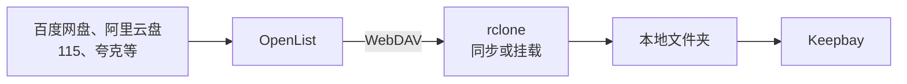

# 云盘和对象存储 {#cloud-storage}

Keepbay 只管理服务器上的本地文件夹，不直接连接 S3、WebDAV 或者各家网盘。

放在云上的文件，要先变成服务器上的一个文件夹，再添加给 Keepbay。本页介绍两种办法：同步到本地，或者挂载成本地文件夹。

## 两种办法 {#approaches}

**同步到本地**：用 rclone、群晖 Cloud Sync 等工具，定时把云上的文件下载到服务器的硬盘上。Keepbay 管理的是本地的副本。

**挂载**：用 rclone 把云盘挂载成一个文件夹，看起来像本地文件夹，实际读文件时才从云上下载。

Keepbay 添加文件夹后，会把每个文件读一遍：算哈希、生成缩略图、提取文字。挂载的话，这些读取都会变成从云上下载。

所以我们的建议是：

- 本地硬盘放得下的，**同步到本地**。速度快，不怕断网，网盘的接口也只在同步时用到
- 资料太多、本地放不下的，用 **rclone 挂载**，并以只读方式添加给 Keepbay。请先看完本页的[注意事项](#caveats)

## 能接入的服务 {#services}

下面的服务都可以用 rclone 同步或挂载。国内网盘 rclone 大多不支持，要先经 OpenList 转成 WebDAV，再交给 rclone。

### S3 兼容的对象存储 {#s3}

用 rclone 的 S3 后端接入：

- 国内：阿里云 OSS、腾讯云 COS、华为云 OBS、七牛云 Kodo、移动云 EOS、UCloud US3、网易对象存储
- 海外：AWS S3、Cloudflare R2、Backblaze B2、Wasabi、群晖 C2、DigitalOcean Spaces、Linode、Scaleway、Hetzner、IDrive e2、IBM COS、Storj
- 自建：MinIO、Ceph、SeaweedFS
- 其他支持 S3 协议的服务，提供商选 `Other`

完整的提供商列表见 [rclone 的 S3 文档](https://rclone.org/s3/)。

### 其他对象存储 {#object-storage}

Azure Blob、Google Cloud Storage、OpenStack Swift、Oracle Object Storage、青云 QingStor，rclone 都有对应的后端。

### 海外网盘 {#global-drives}

rclone 直接支持：

- Google Drive、OneDrive（含 SharePoint）、Dropbox、Box、pCloud
- iCloud Drive、Proton Drive、Mega、Jottacloud、Koofr、Yandex Disk、HiDrive、kDrive
- Seafile、Zoho WorkDrive、PikPak

完整列表见 [rclone 支持的存储](https://rclone.org/overview/)，有 60 多种。

### 国内网盘 {#china-drives}

百度网盘、阿里云盘、115 网盘、夸克网盘、UC 网盘、天翼云盘、中国移动云盘、123 云盘、蓝奏云、迅雷云盘等，rclone 不支持。

可以先装 [OpenList](https://github.com/OpenListTeam/OpenList)，把这些网盘添加进去，由 OpenList 提供 WebDAV，再用 rclone 同步或挂载，见[经 OpenList 接入国内网盘](#openlist)。

OpenList 支持的网盘见它的[文档](https://doc.oplist.org)。

### 协议 {#protocols}

- WebDAV：坚果云、Nextcloud、群晖和威联通的 WebDAV 服务等，用 rclone 的 WebDAV 后端
- SFTP、FTP：用 rclone 对应的后端
- SMB、NFS：NAS 上的共享文件夹，直接用系统的 `mount` 挂载，不需要 rclone，见 [NAS 的共享文件夹](#smb-nfs)

## 安装 rclone {#install-rclone}

用 rclone 官方的安装脚本：

```bash
sudo -v ; curl https://rclone.org/install.sh | sudo bash
```

要挂载的话，还要装 FUSE：

```bash
sudo apt install fuse3        # Debian、Ubuntu
```

系统软件源和 Snap 里的 rclone 可能版本较旧，或者不能挂载，建议用官方脚本安装。

## 添加云存储 {#rclone-config}

运行 `sudo rclone config`，按提示一步步添加。也可以一条命令写好，比如 Cloudflare R2：

```bash
sudo rclone config create r2 s3 \
  provider=Cloudflare \
  access_key_id=您的AccessKey \
  secret_access_key=您的SecretKey \
  endpoint=https://您的账户ID.r2.cloudflarestorage.com
```

阿里云 OSS 的 `provider` 是 `Alibaba`，腾讯云 COS 是 `TencentCOS`，其他服务见 rclone 的文档。

添加后，用 `sudo rclone lsd r2:` 列出存储桶，能列出来就说明配置对了。

配置保存在 `/root/.config/rclone/rclone.conf`，里面有密钥，请不要发给别人。

## 办法一：同步到本地 {#sync}

### 用 rclone 定时同步 {#rclone-sync}

先手动同步一次：

```bash
sudo mkdir -p /srv/cloud/photos
sudo rclone sync r2:photos /srv/cloud/photos --transfers 4 --progress
```

`rclone sync` 会让本地和云上完全一致：云上删除的文件，本地也会删除。只想下载、不删除本地文件的，用 `rclone copy`。

然后用 systemd 定时器每小时同步一次。新建 `/etc/systemd/system/rclone-sync-photos.service`：

```ini
[Unit]
Description=同步云上的照片
After=network-online.target
Wants=network-online.target

[Service]
Type=oneshot
ExecStart=/usr/bin/rclone sync r2:photos /srv/cloud/photos --transfers 4 --config /root/.config/rclone/rclone.conf
```

再新建 `/etc/systemd/system/rclone-sync-photos.timer`：

```ini
[Unit]
Description=每小时同步云上的照片

[Timer]
OnCalendar=hourly
Persistent=true

[Install]
WantedBy=timers.target
```

启用定时器：

```bash
sudo systemctl daemon-reload
sudo systemctl enable --now rclone-sync-photos.timer
```

最后在 Keepbay 中添加 `/srv/cloud/photos`，见[添加给 Keepbay](#add-to-keepbay)。

### 用 NAS 自带的工具 {#nas-sync}

Keepbay 装在 NAS 上的，可以用 NAS 自带的同步工具，不需要 rclone：

- 群晖：Cloud Sync，同步方向选"仅下载远程更改"。支持 C2、阿里云 OSS、腾讯云 COS、S3 兼容存储、Backblaze B2、百度网盘、Dropbox、Box、WebDAV 等
- 威联通：HBS 3 的单向同步，支持 Google Drive、OneDrive、Dropbox、Box、S3 兼容存储、WebDAV 等

OneDrive 也可以用 Linux 上的 [onedrive 客户端](https://github.com/abraunegg/onedrive) 同步到本地。它会把文件全部下载下来。

## 办法二：rclone 挂载 {#mount}

### 挂载命令 {#mount-command}

先手动试一次：

```bash
sudo mkdir -p /mnt/cloud/photos
sudo rclone mount r2:photos /mnt/cloud/photos \
  --read-only \
  --allow-other \
  --dir-cache-time 1000h \
  --vfs-cache-mode full \
  --vfs-cache-max-size 50G \
  --vfs-cache-max-age 720h \
  --cache-dir /var/cache/rclone
```

在另一个终端中运行 `ls /mnt/cloud/photos`，能看到文件就说明挂上了。按 Ctrl + C 停止。

几个参数：

- `--read-only`：只读挂载。Keepbay 以只读方式添加时用不到写入，挂成只读更放心
- `--allow-other`：让 `keepbay` 用户也能读取。不加的话，只有运行 rclone 的用户能看到文件
- `--dir-cache-time 1000h`：目录列表缓存很长时间。rclone 每次重新读取目录，都会给文件换一个 inode，Keepbay 会以为文件变了，再读一遍。缓存时间长，同一次挂载中 inode 就不会变
- `--vfs-cache-mode full`：读过的内容缓存在本地硬盘上，Keepbay 再读同一个文件时不用重新下载
- `--vfs-cache-max-size`：缓存的上限，按硬盘的剩余空间设。实际占用可能会略超过这个值
- `--vfs-cache-max-age 720h`：缓存保留 30 天。默认只保留 1 小时，首次添加时文件要排队处理，同一个文件两次读取之间可能隔了不止 1 小时，缓存过期就得重新下载
- `--cache-dir`：缓存放在哪里，请放在空间足够的硬盘上

### 云上的改动 {#cloud-changes}

`--dir-cache-time` 设得很长，云上的改动（比如在手机 App 里新传的照片）就要等缓存过期才能看到。

Google Drive、OneDrive、Dropbox、Box、pCloud 支持变化通知，rclone 默认每分钟检查一次，云上的改动一分钟左右就能看到。

其他服务，比如 S3、WebDAV，没有变化通知。云上的改动要等重新挂载后才能看到。

所以挂载更适合内容不常变的资料，比如历年的照片和文档归档。经常变的，建议同步到本地。

### 开机自动挂载 {#mount-systemd}

新建 `/etc/systemd/system/rclone-photos.service`：

```ini
[Unit]
Description=挂载云上的照片
After=network-online.target
Wants=network-online.target

[Service]
Type=notify
ExecStart=/usr/bin/rclone mount r2:photos /mnt/cloud/photos \
  --config /root/.config/rclone/rclone.conf \
  --read-only --allow-other \
  --dir-cache-time 1000h \
  --vfs-cache-mode full --vfs-cache-max-size 50G --vfs-cache-max-age 720h \
  --cache-dir /var/cache/rclone
ExecStop=/bin/fusermount -uz /mnt/cloud/photos
Restart=on-failure
RestartSec=10

[Install]
WantedBy=multi-user.target
```

systemd 中没有 `HOME` 环境变量，所以要用 `--config` 写明配置文件的位置。

`Type=notify` 让 systemd 等到挂载完成，才认为这个服务启动好了。

启用：

```bash
sudo systemctl daemon-reload
sudo systemctl enable --now rclone-photos.service
```

### 让 Keepbay 在挂载之后启动 {#mount-order}

Keepbay 比挂载先启动时，看到的是一个空目录，会把文件夹标记为离线。所以要让 Keepbay 等挂载完成再启动：

```bash
sudo systemctl edit keepbay
```

加上：

```ini
[Unit]
After=rclone-photos.service
Wants=rclone-photos.service
```

有多个挂载的，每个都写上。

## 经 OpenList 接入国内网盘 {#openlist}

OpenList 是一个开源的网盘聚合程序，从 AList 分叉而来，支持几十种国内外网盘。

接入的过程是：在 OpenList 中添加网盘，OpenList 对外提供 WebDAV，rclone 再把 WebDAV 同步或挂载到本地。



1. 按 [OpenList 的文档](https://doc.oplist.org) 安装，并添加网盘
2. 在 OpenList 中给一个用户打开「WebDAV 读取」权限。建议单独建一个只读的用户给 rclone 用
3. 网盘的 WebDAV 策略选「本地代理」，兼容性最好，但下载的流量会经过 OpenList 所在的机器
4. 添加到 rclone：

```bash
sudo rclone config create openlist webdav \
  url=http://127.0.0.1:5244/dav \
  vendor=other \
  user=OpenList用户名 \
  pass=OpenList密码
```

`url` 中的地址和端口换成您的 OpenList 的。密码会被 rclone 自动加密保存。

之后的同步和挂载，和上文一样，把 `r2:photos` 换成 `openlist:网盘名称/文件夹` 即可。

OpenList 的 WebDAV 不提供文件哈希。

::: warning 网盘的限速和风控
国内网盘大多限制第三方客户端：可能限速，频繁访问可能被暂时封禁，甚至封号。

Keepbay 首次添加时会把每个文件读一遍，对网盘来说就是一次大量下载。请先用不重要的帐号、少量文件试一试，并降低并发（rclone 加 `--transfers 2 --tpslimit 2`）。

这些限制是网盘自己的规定，Keepbay 和 OpenList 都控制不了。
:::

## 坚果云 {#jianguoyun}

坚果云提供 WebDAV，用 rclone 的 WebDAV 后端接入，`vendor` 填 `other`。密码要用坚果云网页上「安全选项 › 第三方应用管理」中生成的应用密码，不是登录密码。

坚果云限制了 WebDAV 的请求次数：免费版每 30 分钟 600 次，付费版 1500 次。挂载后让 Keepbay 扫描很容易超过，建议定时同步到本地，并加上 `--tpslimit 1`。

## NAS 的共享文件夹 {#smb-nfs}

Keepbay 装在一台机器上，文件在另一台 NAS 上的，用系统自带的 SMB 或 NFS 挂载即可，不需要 rclone。

SMB：

```bash
sudo apt install cifs-utils
sudo mkdir -p /mnt/nas/photos
sudo mount -t cifs //192.168.1.20/photos /mnt/nas/photos \
  -o ro,username=NAS用户名,uid=keepbay,gid=keepbay
```

NFS：

```bash
sudo apt install nfs-common
sudo mount -t nfs 192.168.1.20:/volume1/photos /mnt/nas/photos -o ro
```

开机自动挂载，写进 `/etc/fstab`，并加上 `_netdev`，让系统等网络就绪再挂载。

## 其他工具 {#other-tools}

- s3fs-fuse：把 S3 存储桶挂载成文件夹，维护活跃。只接 S3 的话也可以用它，用法见它的文档
- davfs2：把 WebDAV 挂载成文件夹。它会把打开的文件整个缓存到本地，大文件和大目录效率不如 rclone
- JuiceFS：它把数据切块后存进对象存储，读不了存储桶里原有的文件，不适合这里的用途

没有特别的理由，用 rclone 就好，功能最全，文档也最完整。

## 添加给 Keepbay {#add-to-keepbay}

同步或挂载好以后，在「系统设置 › 存储」中添加这个文件夹，见[文件夹](./folders#add)。

- **访问方式选只读**。同步的文件夹，在 Keepbay 中改了也会被下一次同步覆盖或删掉；挂载的文件夹，Keepbay 改名时要求文件系统支持"不覆盖的改名"或者硬链接，rclone 挂载不一定支持，移动、改名、删除可能失败
- **路径**：添加时 Keepbay 会解析符号链接，保存真实路径。之后这个路径被换成了符号链接（比如改了挂载的位置，再用链接指过去），文件夹会显示"路径指向了别处"
- **定期补扫间隔**：同步的，设得和同步的频率差不多；挂载的，保持默认的 360 分钟即可，云上的改动反正要等缓存刷新才能看到
- 请先确认 `keepbay` 用户能读取这个文件夹：`sudo -u keepbay ls /mnt/cloud/photos`

数据目录（数据库、缩略图）请一定放在本地硬盘上，不要放在挂载的云盘或网络磁盘上。SQLite 数据库放在网络文件系统上会出错。

## 挂载的注意事项 {#caveats}

以下几点是 Keepbay 目前对挂载的云盘的实际表现，用挂载之前请了解。同步到本地的，没有这些问题。

**首次添加会读很多数据。** 64 MB 以内的文件，Keepbay 会整个读一遍算哈希；更大的文件，算哈希时只读开头、中间、结尾几段。

此外，图片还要再读一遍生成缩略图，文档要读一遍提取文字，视频要读取信息、取一帧做缩略图，这些不受 64 MB 的限制。

1 TB 的照片，大约要从云上下载 1 到 2 TB。实际的下载量还取决于文件的格式和 rclone 的缓存。

可以只挂载需要的子文件夹，或者用[忽略规则](./folders#ignore)排除不需要的文件夹，减少读取量。

Keepbay 目前没有"只建目录、不读内容"的省流量选项。缩略图、全文搜索、AI 整理都要读文件内容，这次读取省不掉。能做的是让每个文件只下载一次，并控制下载速度：

- 加 `--vfs-cache-mode full`，把 `--vfs-cache-max-size` 设得够大，`--vfs-cache-max-age` 设得够长。同一个文件第一次处理时会被读好几次，缓存还在就不用重新下载
- 加 `--bwlimit` 限速，比如 `--bwlimit 10M` 是每秒 10 MiB，免得触发网盘的限流

**重新挂载后会再读一遍。** 每次重新挂载，rclone 给每个文件的 inode 都不一样，Keepbay 会把文件当成变了，重新读一遍，64 MB 以上的文件还会重新生成缩略图、重新提取文字。标签、分享链接不受影响。

`--vfs-cache-mode full` 的缓存在重新挂载后还在，缓存中有的内容不用重新下载。但请尽量让挂载一直运行，不要频繁重启。

**重新挂载后，文件夹可能显示离线。** Keepbay 按设备号认磁盘，重新挂载后设备号可能会变，文件夹会显示"离线：磁盘换了"。确认挂载正常后，在「系统设置 › 存储」中点「确认恢复」。

**挂载断开时，文件夹显示离线。** rclone 停了、挂载点被卸载，或者读不了目录时，Keepbay 会把文件夹标记为离线，不会清空索引，标签、AI 结果都保留。挂载恢复后，按上一条处理。

只是网络断了、rclone 还在运行的，目录列表有缓存，文件夹不一定显示离线。这时打开没有缓存的文件会失败，网络恢复后就好了。
