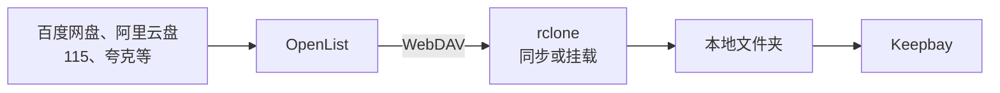

# 云盘 {#cloud-storage}

Keepbay 不直接连接各家网盘。存放在网盘上的文件，需要先成为服务器上的一个文件夹，再添加给 Keepbay。本页介绍两种方式：同步到本地，或者挂载成本地文件夹。

S3 兼容的对象存储、WebDAV 和 SFTP，专业版可以直接添加为[远程文件夹](./remote-folders)，不需要 rclone。国内网盘也可以先添加到 OpenList，再将它的 WebDAV 添加为远程文件夹，见[经 OpenList 接入国内网盘](#openlist)。使用免费版，或者存储不在远程文件夹的支持范围内时，可以按本页的办法接入。

## 两种方式 {#approaches}

**同步到本地**：用 rclone、群晖 Cloud Sync 等工具，定时把云上的文件下载到服务器的硬盘上。Keepbay 管理的是本地的副本。

**挂载**：用 rclone 把云盘挂载为一个文件夹，使用方式与本地文件夹相同，实际读取文件时才从云端下载。

Keepbay 添加文件夹后，会读取每个文件：计算哈希、生成缩略图、提取文字。如果使用挂载，这些读取都会从云端下载。

因此我们建议：

- 本地硬盘空间足够时，**同步到本地**。读取速度快，不受断网影响，网盘的接口也只在同步时调用
- 资料较多、本地空间不足时，用 **rclone 挂载**，并以只读方式添加给 Keepbay。请先阅读本页的[注意事项](#caveats)

## 能接入的服务 {#services}

下面的服务都可以用 rclone 同步或挂载。rclone 大多不支持国内网盘，需要先经 OpenList 转为 WebDAV，再交给 rclone。

### S3 兼容的对象存储 {#s3}

用 rclone 的 S3 后端接入：

- 国内：阿里云 OSS、腾讯云 COS、华为云 OBS、七牛云 Kodo、移动云 EOS、UCloud US3、网易对象存储
- 海外：AWS S3、Cloudflare R2、Backblaze B2、Wasabi、群晖 C2、DigitalOcean Spaces、Linode、Scaleway、Hetzner、IDrive e2、IBM COS、Storj
- 自建：MinIO、Ceph、SeaweedFS
- 其他支持 S3 协议的服务，提供商选 `Other`

完整的提供商列表见 [rclone 的 S3 文档](https://rclone.org/s3/)。

### 其他对象存储 {#object-storage}

Azure Blob、Google Cloud Storage、OpenStack Swift、Oracle Object Storage、青云 QingStor，rclone 都有对应的后端。

### 海外网盘 {#global-drives}

rclone 直接支持：

- Google Drive、OneDrive（含 SharePoint）、Dropbox、Box、pCloud
- iCloud Drive、Proton Drive、Mega、Jottacloud、Koofr、Yandex Disk、HiDrive、kDrive
- Seafile、Zoho WorkDrive、PikPak

完整列表见 [rclone 支持的存储](https://rclone.org/overview/)，有 60 多种。

### 国内网盘 {#china-drives}

百度网盘、阿里云盘、115 网盘、夸克网盘、UC 网盘、天翼云盘、中国移动云盘、123 云盘、蓝奏云、迅雷云盘等，rclone 不支持。

可以先安装 [OpenList](https://github.com/OpenListTeam/OpenList)，把这些网盘添加进去，由 OpenList 提供 WebDAV，再用 rclone 同步或挂载，见[经 OpenList 接入国内网盘](#openlist)。

OpenList 支持的网盘见它的[文档](https://doc.oplist.org)。

### 协议 {#protocols}

- WebDAV：坚果云、Nextcloud、群晖和威联通的 WebDAV 服务等，用 rclone 的 WebDAV 后端。专业版可以直接添加为[远程文件夹](./remote-folders)
- SFTP、FTP：用 rclone 对应的后端。SFTP 专业版可以直接添加为[远程文件夹](./remote-folders#add-sftp)
- SMB、NFS：NAS 上的共享文件夹，直接用系统的 `mount` 挂载，不需要 rclone，见 [NAS 的共享文件夹](#smb-nfs)

## 安装 rclone {#install-rclone}

用 rclone 官方的安装脚本：

```bash
sudo -v ; curl https://rclone.org/install.sh | sudo bash
```

如需挂载，还需要安装 FUSE：

```bash
sudo apt install fuse3        # Debian、Ubuntu
```

系统软件源和 Snap 里的 rclone 可能版本较旧，或者不能挂载，建议用官方脚本安装。

## 添加云存储 {#rclone-config}

运行 `sudo rclone config`，按提示逐步添加。也可以用一条命令完成，比如 Cloudflare R2：

```bash
sudo rclone config create r2 s3 \
  provider=Cloudflare \
  access_key_id=您的AccessKey \
  secret_access_key=您的SecretKey \
  endpoint=https://您的账户ID.r2.cloudflarestorage.com
```

阿里云 OSS 的 `provider` 是 `Alibaba`，腾讯云 COS 是 `TencentCOS`，其他服务见 rclone 的文档。

添加后，用 `sudo rclone lsd r2:` 列出存储桶，能列出存储桶即说明配置正确。

配置保存在 `/root/.config/rclone/rclone.conf`，其中包含密钥，请不要提供给他人。

## 方式一：同步到本地 {#sync}

### 用 rclone 定时同步 {#rclone-sync}

先手动同步一次：

```bash
sudo mkdir -p /srv/cloud/photos
sudo rclone sync r2:photos /srv/cloud/photos --transfers 4 --progress
```

`rclone sync` 会让本地和云上完全一致：云上删除的文件，本地也会删除。如果只需下载、不删除本地文件，请使用 `rclone copy`。

然后用 systemd 定时器每小时同步一次。新建 `/etc/systemd/system/rclone-sync-photos.service`：

```ini
[Unit]
Description=同步云上的照片
After=network-online.target
Wants=network-online.target

[Service]
Type=oneshot
ExecStart=/usr/bin/rclone sync r2:photos /srv/cloud/photos --transfers 4 --config /root/.config/rclone/rclone.conf
```

再新建 `/etc/systemd/system/rclone-sync-photos.timer`：

```ini
[Unit]
Description=每小时同步云上的照片

[Timer]
OnCalendar=hourly
Persistent=true

[Install]
WantedBy=timers.target
```

启用定时器：

```bash
sudo systemctl daemon-reload
sudo systemctl enable --now rclone-sync-photos.timer
```

最后在 Keepbay 中添加 `/srv/cloud/photos`，见[添加给 Keepbay](#add-to-keepbay)。

### 用 NAS 自带的工具 {#nas-sync}

Keepbay 安装在 NAS 上时，可以用 NAS 自带的同步工具，不需要 rclone：

- 群晖：Cloud Sync，同步方向选"仅下载远程更改"。支持 C2、阿里云 OSS、腾讯云 COS、S3 兼容存储、Backblaze B2、百度网盘、Dropbox、Box、WebDAV 等
- 威联通：HBS 3 的单向同步，支持 Google Drive、OneDrive、Dropbox、Box、S3 兼容存储、WebDAV 等

OneDrive 也可以用 Linux 上的 [onedrive 客户端](https://github.com/abraunegg/onedrive) 同步到本地。它会下载全部文件。

## 方式二：rclone 挂载 {#mount}

### 挂载命令 {#mount-command}

先手动试一次：

```bash
sudo mkdir -p /mnt/cloud/photos
sudo rclone mount r2:photos /mnt/cloud/photos \
  --read-only \
  --allow-other \
  --vfs-cache-mode full \
  --vfs-cache-max-size 50G \
  --vfs-cache-max-age 720h \
  --cache-dir /var/cache/rclone
```

在另一个终端中运行 `ls /mnt/cloud/photos`，能看到文件即说明挂载成功。按 Ctrl + C 停止。

几个参数：

- `--read-only`：只读挂载。Keepbay 以只读方式添加时不需要写入，只读挂载更安全
- `--allow-other`：让 `keepbay` 用户也能读取。不加此参数时，只有运行 rclone 的用户能看到文件
- `--vfs-cache-mode full`：读过的内容缓存在本地硬盘上，同一个文件只用下载一次
- `--vfs-cache-max-size`：缓存的上限，按硬盘的剩余空间设。实际占用可能会略超过这个值
- `--vfs-cache-max-age 720h`：缓存保留 30 天。默认只保留 1 小时，首次添加时文件需要排队处理，同一个文件两次读取的间隔可能超过 1 小时，缓存过期后需要重新下载
- `--cache-dir`：缓存的存放位置，请设在空间足够的硬盘上

### 云端的改动 {#cloud-changes}

云端新增、删除的文件（比如在手机 App 中新上传的照片），不会实时通知到 Keepbay。

Keepbay 按文件夹的"补扫间隔"完整读取整个目录，这时才会发现变化。补扫间隔最短 15 分钟。

rclone 自己还有一层目录缓存，`--dir-cache-time` 默认 5 分钟，过期之前列出的仍是旧的目录内容。因此云端的改动要等 rclone 的缓存刷新后，在下一次补扫时才能被发现。

补扫间隔从上一次扫描结束时算起。文件数量多或服务有限速时，单次扫描本身也需要较长时间。

补扫读的是目录列表，大小和修改时间都没变的文件，不会重新下载。

挂载更适合内容不常变的资料，比如历年的照片和文档归档。内容经常变化、需要及时看到改动的，建议同步到本地。

### 开机自动挂载 {#mount-systemd}

新建 `/etc/systemd/system/rclone-photos.service`：

```ini
[Unit]
Description=挂载云上的照片
After=network-online.target
Wants=network-online.target

[Service]
Type=notify
ExecStart=/usr/bin/rclone mount r2:photos /mnt/cloud/photos \
  --config /root/.config/rclone/rclone.conf \
  --read-only --allow-other \
  --vfs-cache-mode full --vfs-cache-max-size 50G --vfs-cache-max-age 720h \
  --cache-dir /var/cache/rclone
ExecStop=/bin/fusermount -uz /mnt/cloud/photos
Restart=on-failure
RestartSec=10

[Install]
WantedBy=multi-user.target
```

systemd 中没有 `HOME` 环境变量，所以要用 `--config` 写明配置文件的位置。

`Type=notify` 使 systemd 在挂载完成后才将这个服务视为已启动。

启用：

```bash
sudo systemctl daemon-reload
sudo systemctl enable --now rclone-photos.service
```

### 让 Keepbay 在挂载之后启动 {#mount-order}

如果 Keepbay 先于挂载启动，读取到的是一个空目录，会把文件夹标记为离线，挂载完成并检查通过后再恢复。如果希望开机时不出现这段离线状态，可以让 Keepbay 在挂载完成后再启动：

```bash
sudo systemctl edit keepbay
```

加上：

```ini
[Unit]
After=rclone-photos.service
Wants=rclone-photos.service
```

有多个挂载时，每个都需要写上。

## 经 OpenList 接入国内网盘 {#openlist}

OpenList 是一个开源的网盘聚合程序，从 AList 分叉而来，支持几十种国内外网盘。

接入的过程是：在 OpenList 中添加网盘，OpenList 对外提供 WebDAV，rclone 再把 WebDAV 同步或挂载到本地。

使用专业版的，也可以不用 rclone，把 OpenList 的 WebDAV 直接添加为[远程文件夹](./remote-folders#add-webdav)。这时下面第 4 步起不用做，OpenList 用户的权限要求见远程文件夹页。



1. 按 [OpenList 的文档](https://doc.oplist.org) 安装，并添加网盘
2. 在 OpenList 中给一个用户打开「WebDAV 读取」权限。建议单独创建一个只读用户供 rclone 使用
3. 网盘的 WebDAV 策略选「本地代理」，兼容性最好，但下载的流量会经过 OpenList 所在的机器
4. 添加到 rclone：

```bash
sudo rclone config create openlist webdav \
  url=http://127.0.0.1:5244/dav \
  vendor=other \
  user=OpenList用户名 \
  pass=OpenList密码
```

将 `url` 中的地址和端口替换为您的 OpenList 的地址和端口。密码会被 rclone 自动加密保存。

之后的同步和挂载与上文相同，把 `r2:photos` 换成 `openlist:网盘名称/文件夹` 即可。

OpenList 的 WebDAV 不提供文件哈希。

::: warning 网盘的限速和风控
国内网盘大多限制第三方客户端：可能限速，频繁访问可能被暂时封禁，甚至封禁帐号。

经 rclone 同步或挂载时，Keepbay 首次添加会读取每个文件，对网盘而言相当于一次大量下载。作为远程文件夹直接添加的，默认只列出文件，打开[处理内容](./remote-folders#process)后才会下载。建议先用不重要的帐号和少量文件测试，并降低并发（rclone 加 `--transfers 2 --tpslimit 2`）。

这些限制由网盘服务自行规定，Keepbay 和 OpenList 都无法控制。
:::

## 坚果云 {#jianguoyun}

坚果云提供 WebDAV。专业版可以直接添加为[远程文件夹](./remote-folders#add-webdav)；免费版用 rclone 的 WebDAV 后端接入，`vendor` 填 `other`。密码要用坚果云网页上「安全选项 › 第三方应用管理」中生成的应用密码，不是登录密码。

坚果云限制了 WebDAV 的请求次数：免费版每 30 分钟 600 次，付费版 1500 次。挂载后由 Keepbay 扫描很容易超出限制，建议定时同步到本地，并加上 `--tpslimit 1`。

## NAS 的共享文件夹 {#smb-nfs}

Keepbay 安装在一台机器上、文件在另一台 NAS 上时，用系统自带的 SMB 或 NFS 挂载即可，不需要 rclone。

SMB：

```bash
sudo apt install cifs-utils
sudo mkdir -p /mnt/nas/photos
sudo mount -t cifs //192.168.1.20/photos /mnt/nas/photos \
  -o ro,username=NAS用户名,uid=keepbay,gid=keepbay
```

NFS：

```bash
sudo apt install nfs-common
sudo mount -t nfs 192.168.1.20:/volume1/photos /mnt/nas/photos -o ro
```

如需开机自动挂载，请写入 `/etc/fstab`，并加上 `_netdev`，使系统在网络就绪后再挂载。

## 其他工具 {#other-tools}

- s3fs-fuse：把 S3 存储桶挂载成文件夹，维护活跃。只接入 S3 时也可以使用它，用法见它的文档
- davfs2：把 WebDAV 挂载成文件夹。它会把打开的文件整个缓存到本地，大文件和大目录效率不如 rclone
- JuiceFS：它把数据切块后存入对象存储，无法读取存储桶中原有的文件，不适合这里的用途

如无特殊需求，建议使用 rclone，它的功能和文档都最完整。

## 添加给 Keepbay {#add-to-keepbay}

同步或挂载完成后，在「系统设置 › 存储」中添加这个文件夹，见[文件夹](./folders#add)。

- **访问方式选只读**。同步的文件夹，在 Keepbay 中做的修改会被下一次同步覆盖或删除。挂载的文件夹，读写方式下大部分操作会失败，见[注意事项](#caveats)。Keepbay 发现路径在 rclone 挂载上时，会自动选择只读
- **路径**：添加时 Keepbay 会解析符号链接，保存真实路径。如果之后这个路径被替换为符号链接（比如更改了挂载位置，再用链接指向新位置），文件夹会显示"路径指向了别处"
- **定期补扫间隔**：同步的文件夹，设为与同步频率相近。挂载的文件夹，如需更早发现云端的改动，可以调短，最短 15 分钟。每次补扫都要向云端列出一次目录，对于按请求次数收费或限制请求次数的服务（比如坚果云），不建议设得太短
- **权限**：rclone 挂载的文件夹不支持 `mount:grant` 那样的授权，通过挂载命令中的 `--allow-other` 使 `keepbay` 用户能够读取。请先用以下命令确认：`sudo -u keepbay ls /mnt/cloud/photos`

数据目录（数据库、缩略图）请确保放在本地硬盘上，不要放在挂载的云盘或网络磁盘上。SQLite 数据库放在网络文件系统上会出错。

## 挂载的注意事项 {#caveats}

以下几点是 Keepbay 目前对挂载的云盘的实际表现，使用挂载前请先了解。同步到本地时不存在这些问题。

**首次添加会读取大量数据。** 64 MB 以内的文件，Keepbay 会完整读取以计算哈希；更大的文件，计算哈希时只读取开头、中间、结尾几段。

此外，图片还需要再读取一次以生成缩略图，文档需要读取一次以提取文字，视频需要读取信息并取一帧做缩略图，这些不受 64 MB 的限制。

1 TB 的照片，大约需要从云端下载 1 到 2 TB。实际的下载量还取决于文件的格式和 rclone 的缓存。

可以只挂载需要的子文件夹，或者用[忽略规则](./folders#ignore)排除不需要的文件夹，减少读取量。

Keepbay 目前没有"只建目录、不读内容"的省流量选项。缩略图、全文搜索、AI 整理都需要读取文件内容，这部分读取无法省去。可以做的是让每个文件只下载一次，并控制下载速度：

- 加 `--vfs-cache-mode full`，把 `--vfs-cache-max-size` 设置得足够大，`--vfs-cache-max-age` 设置得足够长。第一次处理一个文件时的几次读取，合并成一次下载
- 加 `--bwlimit` 限速，比如 `--bwlimit 10M` 是每秒 10 MiB，避免触发网盘的限流

这部分流量只产生一次。之后重新挂载或重启服务器时，Keepbay 按文件的大小和修改时间识别文件，没有变化的文件不会再次读取。

**建议以只读方式添加。** rclone 挂载不支持"不覆盖的改名"，也不支持硬链接。Keepbay 改名、移动时依靠这两项功能确保不覆盖其他文件，不支持时不会执行这些操作。

因此在读写方式下，上传、改名、移动、移入回收站都会失败，提示"这个磁盘不支持安全改名"。可用的只有新建文件和文件夹，实际用途有限。

**挂载断开时，文件夹显示离线。** rclone 停止运行、挂载点被卸载，或者无法读取目录时，Keepbay 会把文件夹标记为离线，不会清空索引，标签、AI 结果都保留。

重新挂载同一个云盘后，Keepbay 会抽查其中的文件，与索引一致时自动恢复在线，无需手动确认，设备号变化时也是如此。

前提是添加给 Keepbay 的是挂载点本身，比如上文的 `/mnt/cloud/photos`。如果添加的是挂载中的子文件夹，且重新挂载后设备号发生了变化，Keepbay 无法判断是否为同一块磁盘，需要手动确认。

如果离线期间云端的文件大部分被修改或删除，抽查结果与索引不一致，同样需要手动确认。

需要手动确认时，在「系统设置 › 存储」中点击「确认恢复」。

如果只是网络中断、rclone 仍在运行，由于目录列表有缓存，文件夹不一定显示离线。这时打开没有缓存的文件会失败，网络恢复后即可正常打开。

**Keepbay 运行时可以卸载。** Keepbay 不会持续占用挂载点，用 `fusermount -u` 卸载、重启 rclone 服务前都不需要先停止 Keepbay。

**S3 上的空文件夹。** S3 没有真正的文件夹，挂载后新建的空文件夹，重新挂载后会消失。如需保留空文件夹，rclone 挂载时加 `--s3-directory-markers`。

**WebDAV 的修改时间。** 经 OpenList 等 WebDAV 服务挂载时，可能不保留文件原来的修改时间，Keepbay 中显示的是上传到网盘的时间。
