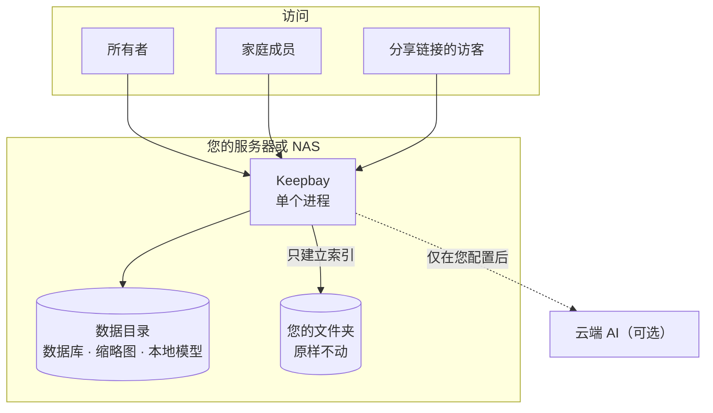

# Keepbay 介绍 {#introduce}

Keepbay 是一个自部署的私有网盘，装在您自己的服务器或 NAS 上，给您和家人用。名字是 keep 和 bay 拼起来的：一个把东西收好的港湾。

它和大多数网盘最大的不同是：**文件留在原来的文件夹里**，Keepbay 只建立索引，在此基础上做文件管理、搜索和分享；专业版再加上 AI 整理和搜索，AI 默认在您自己的设备上运行。

::: warning 内测阶段
Keepbay 目前处于内测阶段（0.1.0-beta），功能和界面还会调整，暂时只提供 Linux 安装包。用于存放重要资料前，请先做好备份。
:::

想先看看效果？打开演示站 [demo.keepbay.app](https://demo.keepbay.app)，用帐号 `demo` 或 `family` 登录，密码 `keepbay-demo`。演示站每小时恢复一次，随便折腾。已经决定要装了？跳到[安装](./install)。

## 为什么以文件夹为准 {#folders-first}

很多网盘会把文件导入自己的存储，换成只有它才认得的结构。用着挺好，直到有一天程序出了问题、或者想换一个，才发现文件被"锁"在了里面。

Keepbay 反过来：您的文件夹原样不动，名字和目录结构都不变，Keepbay 只是把它们"挂载"进来读一遍，建立索引。

NAS 自带的文件管理、SMB 共享、Jellyfin、相册程序、Syncthing、备份任务照常工作，它们在外面做的改动 Keepbay 会发现并更新索引。哪天 Keepbay 崩溃了、卸载了，文件一个都不会少。

AI 也遵守这个原则：它只给已有的文件打标签、建智能文件夹，不挪动磁盘上的任何东西。一家人共用的文件夹被 AI 擅自"整理"一遍，第二天谁都找不到东西，这种事我们不干。只有放进收件箱的新文件，才会按您定的规则归档到合适的文件夹，每一次移动都有记录、可以撤销。

## 主要功能 {#features}

免费版是一个完整的私有网盘，不限文件夹数量，也不限文件数量；专业版在此基础上解锁 AI 功能，用户数不限。

| 功能 | 说明 | 免费版 | 专业版 |
|---|---|:---:|:---:|
| 文件管理 | 列表和网格视图，十万个文件的文件夹照样流畅；拖放、多选、快捷键；移动、复制、改名、删除都能撤销 | ✓ | ✓ |
| 上传和回收站 | 上传支持断点续传，删除的文件先进回收站 | ✓ | ✓ |
| 预览 | 图片（包括相机 RAW）、视频、音频、PDF、Office 文档、文本和代码 | ✓ | ✓ |
| 搜索 | 按文件名（支持拼音首字母），以及有文字层的文档全文 | ✓ | ✓ |
| 标签和智能文件夹 | 手动打标签，把常用的搜索条件存成智能文件夹 | ✓ | ✓ |
| 分享链接 | 可以设密码、有效期和下载次数 | ✓ | ✓ |
| 家庭成员 | 按文件夹授权只读或读写 | 最多 2 人（含所有者） | 不限 |
| 登录安全 | 两步验证、通行密钥，以及用 Authentik、Keycloak、Google、Microsoft、GitHub 等外部帐号登录 | ✓ | ✓ |
| 离线下载 | 让服务器去下载网址、磁力链接，装了 yt-dlp 还能下载视频网站的视频 | ✓ | ✓ |
| 访问记录、自动备份、在线更新 | | ✓ | ✓ |
| 语义搜索 | 按意思搜文档，按画面搜照片，搜照片里的文字。"去年在海边拍的那张"不用再翻一下午 | — | ✓ |
| AI 桌面 | 用聊天的方式找文件、整理文件。要动文件时，它先列出计划，您点了确认才执行 | — | ✓ |
| 收件箱自动整理 | 新文件按规则或 AI 的建议归档到合适的文件夹 | — | ✓ |
| AI 标签 | 自动给文件打标签 | — | ✓ |
| 重要日期提醒 | 从护照、合同、保单里读出到期日，确认后通过 Bark 或邮件提醒，免得出发前一天才发现护照过期了 | — | ✓ |
| 证件照水印 | 分享身份证照片前，加上"仅用于某某用途"的水印 | — | ✓ |

降级回免费版时，您的文件不受任何影响，已有的标签和整理结果都留着，重新激活后直接恢复。两步验证、通行密钥、外部帐号登录这些安全功能永远免费，我们不拿安全收钱。

## 系统架构 {#architecture}

Keepbay 是一个 Go 程序，前端页面编译在程序里，数据存在一个 SQLite 数据库中。不用另装数据库、Web 服务器或运行环境，解压就能跑。

想知道扫描、索引、任务队列、AI 调用具体怎么做的，见[技术架构](./architecture)。

## 隐私 {#privacy}

数据只在您自己的设备上，不经过我们或任何第三方平台；AI 默认在本地处理，用云端模型时写明发送什么、发给谁；登录、下载、分享和每一次 AI 调用都有记录；程序不收集任何数据，没有统计和追踪。

Keepbay 什么时候联网、发了什么，我们在[隐私与安全](./privacy)中一项一项列出来了。

## 所有者、成员和访客 {#roles}

第一个帐号是**所有者**，在首次设置时创建，管理文件夹、成员、AI 模型等所有设置。

家里其他人是**成员**，只能看到所有者授权给他的文件夹。创建分享链接、使用云端 AI、离线下载这三件事都会让数据离开这台设备或让它访问外网，所以默认都不能做，由所有者按人打开。

打开分享链接的人是**访客**，不需要帐号，只能看到分享给他的内容。
