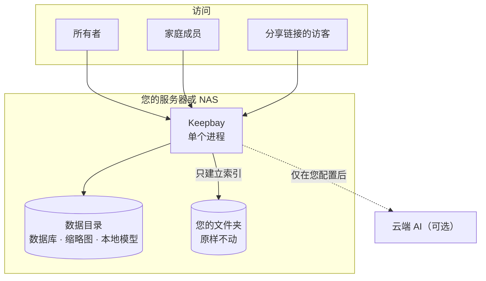

# Keepbay 介绍 {#introduce}

Keepbay 是一个自部署的私有网盘，装在您自己的服务器或 NAS 上，给您和家人用。名字是 keep 和 bay 拼起来的：一个把东西收好的港湾。

它和大多数网盘最大的不同是：**文件留在原来的文件夹里**。Keepbay 只建立索引，在此基础上做文件管理、搜索和分享。

专业版再加上 AI 整理和搜索。AI 默认在您自己的设备上运行。

::: warning 内测阶段
Keepbay 目前处于内测阶段（0.1.0-beta），功能和界面还会调整，暂时只提供 Linux 安装包。用于存放重要资料前，请先做好备份。
:::

想先看看效果？打开演示站 [demo.keepbay.app](https://demo.keepbay.app)，用帐号 `demo` 或 `family` 登录，密码 `keepbay-demo`。演示站每小时恢复一次。已经决定要装了？跳到[安装](./install)。

## 为什么以文件夹为准 {#folders-first}

很多网盘会把文件导入自己的存储，换成只有它才认得的结构。程序出了问题，或者想换一个时，文件不容易取出来。

Keepbay 的做法是：您的文件夹原样不动，名字和目录结构都不变。Keepbay 只是把它们"挂载"进来读一遍，建立索引。

NAS 自带的文件管理、SMB 共享、Jellyfin、相册程序、Syncthing、备份任务照常工作。它们在外面做的改动，Keepbay 会发现并更新索引。

哪天 Keepbay 崩溃了、卸载了，文件一个都不会少。

AI 也遵守这个原则：它只给已有的文件打标签、建智能文件夹，不挪动磁盘上的任何东西。一家人共用的文件夹被 AI 擅自整理后，其他人就找不到东西了。

只有放进收件箱的新文件，才会按您定的规则归档到合适的文件夹。每一次移动都有记录，可以撤销。

## 隐私与安全 {#privacy}

照片、证件、合同、病历，家里最私密的东西都会放进网盘。所以隐私与安全是我们做 Keepbay 时最先考虑的事，下面是我们的几条承诺。

### 数据只在您自己的设备上 {#privacy-local}

文件在您自己的硬盘上，索引、缩略图、设置存在您自己的服务器上。不需要注册我们的帐号，数据不经过我们或任何第三方平台。

### 不收集任何数据 {#privacy-no-telemetry}

程序中没有统计、遥测和崩溃上报。网页不加载任何第三方的脚本、字体或图片。

Keepbay 主动联网的情况只有几种：检查更新、激活专业版、下载本地模型，以及您自己配置的云端 AI、外部登录、通知和离线下载。

检查更新只发送产品名称和是否接收测试版，不发送安装 ID 和这台设备的任何信息。每种情况发送什么，见[隐私与安全](./privacy#outbound)。

### AI 默认在本地 {#privacy-ai}

语义搜索、按画面搜图、识别图片中的文字，都有本地模型，在您的设备上运行，什么都不发出去。其中按画面搜图和识别文字只能用本地模型，照片从来不会发给云端。

要用云端模型，由您决定。界面上写明每项功能会发送什么、发给谁。

在后台自动处理文件的功能，选了云端模型也不会马上发送，要所有者逐项再允许一次。

每一次 AI 调用都有记录：谁发起的、哪项功能、发送了哪类数据、花了多少钱。

### 家里人也分得清 {#privacy-family}

成员只能看到所有者授权给他的文件夹，其他文件夹他看不到，也不知道它们存在。

创建分享链接、使用云端 AI、离线下载，这三件事会让数据离开这台设备，成员默认都不能做，要所有者按人打开。

### 每次访问都有记录 {#privacy-log}

登录、下载、创建分享链接，以及分享链接的访客打开和下载，都记在访问记录中，保留 180 天。

文件放在家里的服务器上，您应该能知道有谁来过、拿走了什么。

### 分享出去也有分寸 {#privacy-share}

分享链接默认 7 天后失效，可以设密码、下载次数和限速。

分享带拍摄地点的照片时，Keepbay 会提醒您。分享证件照时，可以加上"仅用于某某用途"的水印（专业版），访客拿不到原图。

### 登录和文件处理 {#privacy-security}

两步验证、通行密钥、外部帐号登录都是免费的，我们不拿安全功能收费。登录失败多次会限流和锁定。

照片在一个受限的子进程中解码。这个进程不能联网、不能打开其他文件。有人用一张特制的图片攻破了解码器，也读不到数据库和密钥，发不出去任何东西。

视频和 HEIC 交给 ffmpeg 处理，它的限制宽一些：可以只读打开文件，但不能联网、不能写文件、不能创建新的进程。

### 我们不承诺的 {#privacy-limits}

Keepbay 没有做端到端加密。服务端要给文件生成缩略图、提取文字、交给 AI 分析，加密了这些都做不了。

所以我们不说"零知识""只有您能看到"这类话。服务器本身的安全，比如系统更新、防火墙、磁盘加密，仍然要靠您来照顾。

更详细的说明，包括密钥怎么保存、请求经过哪些检查，见[隐私与安全](./privacy)。

## 主要功能 {#features}

免费版是一个完整的私有网盘，不限文件夹数量，也不限文件数量。专业版在此基础上解锁 AI 功能，用户数不限。

| 功能 | 说明 | 免费版 | 专业版 |
|---|---|:---:|:---:|
| 文件管理 | 列表和网格视图，十万个文件的文件夹照样流畅；拖放、多选、快捷键；移动、复制、改名、删除都能撤销 | ✓ | ✓ |
| 上传和回收站 | 上传支持断点续传，删除的文件先进回收站 | ✓ | ✓ |
| 预览 | 图片（包括相机 RAW）、视频、音频、PDF、Office 文档、文本和代码 | ✓ | ✓ |
| 搜索 | 按文件名（支持拼音首字母），以及有文字层的文档全文 | ✓ | ✓ |
| 标签和智能文件夹 | 手动打标签，把常用的搜索条件存成智能文件夹 | ✓ | ✓ |
| 分享链接 | 可以设密码、有效期和下载次数 | ✓ | ✓ |
| 家庭成员 | 按文件夹授权只读或读写 | 最多 2 人（含所有者） | 不限 |
| 登录安全 | 两步验证、通行密钥，以及用 Authentik、Keycloak、Google、Microsoft、GitHub 等外部帐号登录 | ✓ | ✓ |
| 离线下载 | 让服务器去下载网址、磁力链接，装了 yt-dlp 还能下载视频网站的视频 | ✓ | ✓ |
| 访问记录、自动备份、在线更新 | | ✓ | ✓ |
| 语义搜索 | 按意思搜文档，按画面搜照片，搜照片里的文字。"去年在海边拍的那张"不用再翻一下午 | — | ✓ |
| AI 桌面 | 用聊天的方式找文件、整理文件。要动文件时，它先列出计划，您点了确认才执行 | — | ✓ |
| 收件箱自动整理 | 新文件按规则或 AI 的建议归档到合适的文件夹 | — | ✓ |
| AI 标签 | 自动给文件打标签 | — | ✓ |
| 重要日期提醒 | 从护照、合同、保单里读出到期日，确认后通过 Bark 或邮件提醒，免得出发前一天才发现护照过期了 | — | ✓ |
| 证件照水印 | 分享身份证照片前，加上"仅用于某某用途"的水印 | — | ✓ |

降级回免费版时，您的文件不受任何影响，已有的标签和整理结果都留着，重新激活后直接恢复。价格和授权方式见[专业版](./pro)。

## 系统架构 {#architecture}

Keepbay 是一个 Go 程序，前端页面编译在程序里，数据存在一个 SQLite 数据库中。

不用另装数据库、Web 服务器或运行环境，解压就能运行。

想知道扫描、索引、任务队列、AI 调用具体怎么做的，见[技术架构](./architecture)。

## 所有者、成员和访客 {#roles}

第一个帐号是**所有者**，在首次设置时创建，管理文件夹、成员、AI 模型等所有设置。

家里其他人是**成员**，只能看到所有者授权给他的文件夹，见[成员和权限](./members)。

打开分享链接的人是**访客**，不需要帐号，只能看到分享给他的内容，见[分享和水印](./share)。
