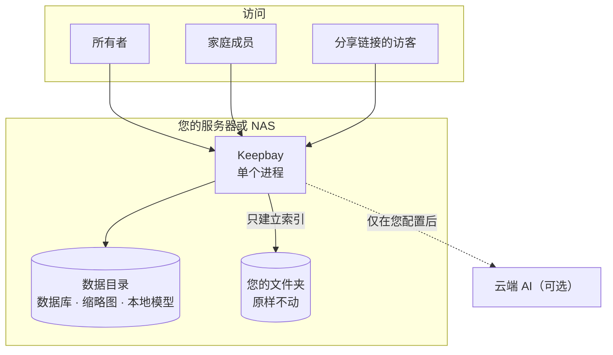

# Keepbay 介绍 {#introduce}

Keepbay 是一个自部署的私有网盘，装在您自己的服务器或 NAS 上，供您和家人使用。名称由 keep 和 bay 组合而成。

它和大多数网盘最大的不同是：**文件留在原来的文件夹里**。Keepbay 只建立索引，在此基础上做文件管理、搜索和分享。

专业版增加 AI 整理和搜索功能。AI 默认在您自己的设备上运行。

::: warning 内测阶段
Keepbay 目前处于内测阶段（0.1.0-beta），功能和界面还会调整，暂时只提供 Linux 安装包。用于存放重要资料前，请先做好备份。

遇到问题或有建议，请在 [GitHub](https://github.com/huohuastudio/keepbay-releases/issues) 上提交 Issue。
:::

如需先体验，可以打开演示站 [demo.keepbay.app](https://demo.keepbay.app)，用帐号 `demo` 或 `family` 登录，密码 `keepbay-demo`。演示站每小时恢复一次。安装步骤见[安装](./install)。

## 为什么以文件夹为准 {#folders-first}

很多网盘会把文件导入自己的存储，转换为专有的结构。程序出现问题或需要更换时，文件难以取出。

Keepbay 的做法是：您的文件夹原样不动，名字和目录结构都不变。Keepbay 只是将它们"挂载"进来读取，建立索引。

NAS 自带的文件管理、SMB 共享、Jellyfin、相册程序、Syncthing、备份任务照常工作。这些程序对文件的改动，Keepbay 会检测到并更新索引。

即使 Keepbay 崩溃或被卸载，文件也不受影响。

AI 也遵守这个原则：它不会自己去整理已有的文件夹，只给文件打标签。家庭共用的文件夹如果被 AI 自动整理，其他成员会找不到原来的文件。

Keepbay 替您移动文件，只有两种情况：您指定为收件箱的文件夹，其中的文件按您定的规则或 AI 的建议归档；或者您在 AI 桌面确认了它列出的计划。每一次移动都有记录，可以撤销。

## 隐私与安全 {#privacy}

照片、证件、合同、病历等私密资料都会存放在网盘中。因此隐私与安全是我们设计 Keepbay 时首先考虑的问题，以下是我们的几项承诺。

### 数据只在您自己的设备和存储上 {#privacy-local}

文件在您自己的硬盘上，索引、缩略图、设置存在您自己的服务器上。不需要注册我们的帐号，数据不经过我们。除了您自己配置的服务，也不经过任何第三方平台。

使用远程文件夹时，这部分文件存放在您自己选择的远程存储上，Keepbay 直接和它连接，同样不经过我们。

### 不收集任何数据 {#privacy-no-telemetry}

程序中没有统计、遥测和崩溃上报。网页不加载任何第三方的脚本、字体或图片。

Keepbay 主动联网的情况只有几种：检查和安装更新、激活和续期专业版、下载本地模型，以及您自己配置的云端 AI、远程存储、外部登录、通知、离线下载、测试代理和自定义的模型清单。

检查更新只发送产品名称和是否接收测试版，不发送安装 ID 和这台设备的任何信息。每种情况发送什么，见[隐私与安全](./privacy#outbound)。

### AI 默认在本地 {#privacy-ai}

语义搜索、按画面搜图、识别图片中的文字，都有本地模型，在您的设备上运行，不向外发送任何数据。其中按画面搜图和识别文字只能使用本地模型，照片不会发送到云端。

要用云端模型，由您决定。界面上写明每项功能会发送什么、发给谁。

自动整理、AI 标签、日期提醒在后台自动处理文件，选择云端模型后也不会立即发送，需要所有者逐项再次允许。

每一次 AI 调用都有记录：发起人、功能、发送的数据类型和费用。

### 成员权限 {#privacy-family}

成员只能看到所有者授权给他的文件夹，其他文件夹对他不可见，也不会显示它们的存在。

创建分享链接、使用云端 AI、离线下载，这三项操作会让数据离开这台设备，成员默认没有权限，需要所有者为其单独开启。

### 每次访问都有记录 {#privacy-log}

登录、下载、创建分享链接，以及分享链接的访客打开和下载，都记在访问记录中，保留 180 天。

文件存放在家中的服务器上，您可以随时查看谁访问过、下载了哪些文件。

### 分享的控制 {#privacy-share}

分享链接默认 7 天后失效，可以设密码、下载次数和限速。

分享带拍摄地点的照片时，Keepbay 会提醒您。分享证件照时，可以加上"仅用于某某用途"的水印（专业版），访客无法获取原图。

### 登录和文件处理 {#privacy-security}

两步验证、通行密钥、外部帐号登录均为免费功能，安全功能不收费。多次登录失败会触发限流和锁定。

照片在一个受限的子进程中解码。这个进程不能联网、不能打开其他文件。即使解码器被特制的图片攻破，攻击者也无法读取数据库和密钥，无法向外发送数据。

视频和 HEIC 由 ffmpeg 处理，限制相对宽松：可以只读打开文件，但不能联网、不能写文件、不能创建新的进程。

部分 NAS 的内核不支持这种隔离，Keepbay 默认不处理照片和视频。所有者可以选择照样处理，这时上面的限制不再生效，见[隐私与安全](./privacy#sandbox)。

### 我们不承诺的 {#privacy-limits}

Keepbay 没有做端到端加密。服务端需要为文件生成缩略图、提取文字、交给 AI 分析，加密后无法进行这些处理。

因此我们不使用"零知识""只有您能看到"这类表述。服务器本身的安全，如系统更新、防火墙、磁盘加密，仍需由您负责。

更详细的说明，包括密钥怎么保存、请求经过哪些检查，见[隐私与安全](./privacy)。

## 主要功能 {#features}

免费版是一个完整的私有网盘，不限文件夹数量，也不限文件数量。专业版在此基础上解锁 AI 功能和远程文件夹，用户数不限。

| 功能 | 说明 | 免费版 | 专业版 |
|---|---|:---:|:---:|
| 文件管理 | 列表和网格视图，包含十万个文件的文件夹也能流畅浏览；拖放、多选、快捷键；移动、复制、改名、移到回收站都能撤销 | ✓ | ✓ |
| 上传和回收站 | 上传支持断点续传，删除的文件先进回收站 | ✓ | ✓ |
| 预览 | 图片（包括相机 RAW）、视频、音频、PDF、Office 文档、文本和代码 | ✓ | ✓ |
| 搜索 | 按文件名（支持拼音首字母），以及有文字层的文档全文 | ✓ | ✓ |
| 标签和智能文件夹 | 手动打标签，把常用的搜索条件存成智能文件夹 | ✓ | ✓ |
| 分享链接 | 可以设密码、有效期和下载次数 | ✓ | ✓ |
| 家庭成员 | 按文件夹授权只读或读写 | 最多 2 人（含所有者） | 不限 |
| 登录安全 | 两步验证、通行密钥，以及用 Authentik、Keycloak、Google、Microsoft、GitHub 等外部帐号登录 | ✓ | ✓ |
| 离线下载 | 由服务器下载网址、磁力链接，安装 yt-dlp 后还可以下载视频网站的视频 | ✓ | ✓ |
| 访问记录、自动备份、在线更新 | | ✓ | ✓ |
| 语义搜索 | 按语义搜索文档，按画面搜索照片，搜索照片中的文字 | — | ✓ |
| AI 桌面 | 通过对话查找和整理文件。需要改动文件时，先列出计划，经您确认后才执行 | — | ✓ |
| 收件箱自动整理 | 收件箱中的文件按规则或 AI 的建议归档到合适的文件夹 | — | ✓ |
| AI 标签 | 自动给文件打标签 | — | ✓ |
| 重要日期提醒 | 从护照、合同、保单里读出到期日，确认后通过 Bark 或邮件提醒 | — | ✓ |
| 证件照水印 | 分享身份证照片前，加上"仅用于某某用途"的水印 | — | ✓ |
| [远程文件夹](./remote-folders) | 直接连接 Cloudflare R2、阿里云 OSS、MinIO 等 S3 兼容的对象存储，以及坚果云、Nextcloud 等 WebDAV，文件留在存储上 | — | ✓ |

降级为免费版时，您的文件不受影响，已有的标签和整理结果都会保留，重新激活后直接恢复。价格和授权方式见[专业版](./pro)。

## 系统架构 {#architecture}

Keepbay 是一个 Go 程序，前端页面编译在程序里，数据存在一个 SQLite 数据库中。

无需另外安装数据库、Web 服务器或运行环境，解压即可运行。

扫描、索引、任务队列、AI 调用的具体实现见[技术架构](./architecture)。

## 所有者、成员和访客 {#roles}

第一个帐号是**所有者**，在首次设置时创建，管理文件夹、成员、AI 模型等所有设置。

其他家庭成员是**成员**，只能看到所有者授权给他的文件夹，见[成员和权限](./members)。

打开分享链接的人是**访客**，不需要帐号，只能看到分享给他的内容，见[分享和水印](./share)。
