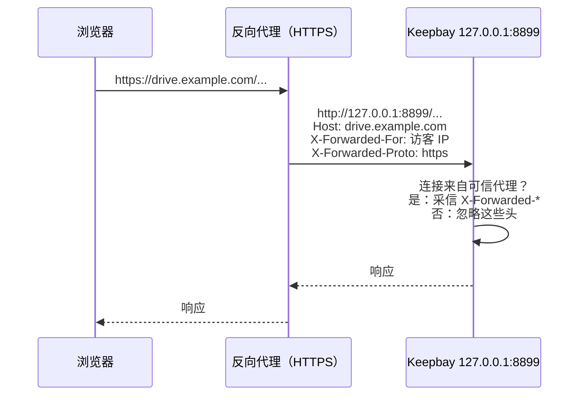

# 外网访问 {#remote-access}

Keepbay 安装后监听 `8899` 端口，在家中的局域网内直接用 `http://<服务器地址>:8899` 访问即可。从外网访问需要另外配置。

**不要把 8899 端口直接映射到公网**。这个端口是普通的 HTTP，没有加密，密码、会话和文件都以明文在网上传输。登录限流和锁定无法防止传输过程中的窃听。

我们没有在程序中内置自动申请 HTTPS 证书的功能，因为家用宽带大多没有公网的 80、443 端口，内置后也无法使用。

以下三种方式任选其一，按配置难度从低到高排列。

## Tailscale {#tailscale}

配置最简单，无需开放任何端口，也无需购买域名。

在服务器和手机、电脑上安装 [Tailscale](https://tailscale.com) 并登录同一个帐号，这些设备即可组成一个虚拟局域网，用 Tailscale 分配的地址访问即可：

```
http://<服务器的 Tailscale 地址>:8899
```

Tailscale 的连接本身是加密的，因此这里可以使用 HTTP。

如需 HTTPS 地址（使用通行密钥时需要，见[下文](#passkey)），可以用 Tailscale 转发：

```bash
sudo tailscale serve --bg 8899
```

此时 `tailscale serve` 相当于一个反向代理，需要按[可信代理](#trusted-proxies)一节把 `127.0.0.1,::1` 设为可信代理，否则登录时会提示"请求来源不正确"。

## NAS 自带的远程访问 {#nas}

群晖、威联通、飞牛等 NAS 都有自己的远程访问或反向代理功能，用法与下面的反向代理相同：把一个域名（或子路径）转发到 `127.0.0.1:8899`，按要求转发几个请求头，再设置可信代理。

各品牌的界面不同，请查找"反向代理"或"自定义标题"等设置项。

## 反向代理 {#reverse-proxy}

有公网 IP 和域名时，用 Caddy、nginx 等反向代理提供 HTTPS，再转发给 Keepbay。

请求经过代理的过程如下：



代理需要满足以下要求：

1. 原样转发 `Host`，并写好 `X-Forwarded-Host`、`X-Forwarded-For`、`X-Forwarded-Proto`
2. 不限制请求体大小，至少要能容纳 16 MiB（16,777,216 字节）：网页上传时每块 16 MiB
3. 不缓冲响应，读超时不能过短：任务进度通过 SSE 长连接推送，下载大文件也需要较长时间
4. 在 Keepbay 中设置[可信代理](#trusted-proxies)

Keepbay 不使用 WebSocket，无需配置 `Upgrade` 相关的头。

### Caddy {#caddy}

Caddy 会自动申请证书，默认转发上述请求头，配置最简洁：

```
drive.example.com {
    reverse_proxy 127.0.0.1:8899
}
```

### nginx {#nginx}

```nginx
server {
    listen 443 ssl;
    server_name drive.example.com;
    # ssl_certificate 等证书配置略

    client_max_body_size 0;            # 不限制上传大小

    location / {
        proxy_pass http://127.0.0.1:8899;
        proxy_http_version 1.1;
        proxy_set_header Connection "";
        proxy_set_header Host $http_host;
        proxy_set_header X-Forwarded-Host $http_host;
        proxy_set_header X-Forwarded-For $remote_addr;   # 覆盖而不是追加，访客伪造的值传不进来
        proxy_set_header X-Forwarded-Proto $scheme;
        proxy_buffering off;               # SSE 和大文件下载不要先攒在代理里
        proxy_request_buffering off;       # 上传边收边转
        proxy_read_timeout 1h;
        proxy_send_timeout 1h;
    }
}
```

`Host` 用 `$http_host` 而不是 `$host`：后者会丢失端口号，代理不在 443 端口时，会导致 Keepbay 计算出的来源与浏览器的不一致。

## 可信代理 {#trusted-proxies}

代理转发的请求，对 Keepbay 而言都来自 `127.0.0.1`。访客的真实 IP、原始域名、是否使用 HTTPS，都记录在 `X-Forwarded-*` 请求头中。

但这些请求头可以被任意伪造，因此 Keepbay 默认不采信，只有连接来自您指定的可信代理时才采信。

```bash
sudo systemctl edit keepbay
```

写入下面两行，保存后重启：

```ini
[Service]
Environment=KEEPBAY_TRUSTED_PROXIES=127.0.0.1,::1
```

```bash
sudo systemctl restart keepbay
```

代理和 Keepbay 在同一台机器上时，填写 `127.0.0.1,::1`。

代理在其他机器上时，填写代理的 IP 或网段，如 `192.168.1.10` 或 `192.168.1.0/24`。多个地址用逗号分隔，不支持主机名。

设置后：

真实 IP：从 `X-Forwarded-For` 的最右边向左查找，跳过可信代理，第一个不可信的地址即为访客地址。最左边的值可以由访客任意填写，因此不直接采用。登录限流、访问记录、分享链接限流都按这个 IP 计算。

域名和协议：取 `X-Forwarded-Host` 和 `X-Forwarded-Proto` 的最后一个值，用于跨站请求检查、Cookie 的 `Secure` 属性和通行密钥。

未设置可信代理就通过代理访问，会出现两个问题。

一是登录、上传等操作提示"请求来源不正确，请刷新页面后重试"。原因是 Keepbay 认为自己的地址是 `http://127.0.0.1:8899`，而浏览器发送的来源是 `https://drive.example.com`，两者不一致。

二是所有人的 IP 都显示为代理的地址，任何一个人多次输错密码，所有用户都会被限流。

## 子路径 {#base-path}

如需将 Keepbay 部署在 `https://example.com/keepbay/` 这样的子路径下，再添加一行：

```ini
[Service]
Environment=KEEPBAY_TRUSTED_PROXIES=127.0.0.1,::1
Environment=KEEPBAY_BASE_PATH=/keepbay/
```

前后的斜杠可以省略，`keepbay`、`/keepbay` 都会变成 `/keepbay/`。只能包含字母、数字和 `.` `_` `~` `-`。

**代理不能去掉前缀**，请原样转发，前缀由 Keepbay 处理。

nginx 中 `proxy_pass` 的地址后面不带路径时，转发会保留前缀：

```nginx
location /keepbay/ {
    proxy_pass http://127.0.0.1:8899;
    # 其余同上
}
```

## 通行密钥 {#passkey}

通行密钥（Passkey）绑定在域名上，浏览器只在 HTTPS 或 `localhost` 下允许使用。所以：

- 用 IP 地址访问时不能使用，提示"通行密钥需要通过域名访问"
- 在局域网中使用 `http://nas.local:8899` 这类地址也不能使用，需要经过 HTTPS 代理或 `tailscale serve`
- 更换域名后，原来添加的通行密钥在新域名下无法使用，需要重新添加

密码和两步验证不受这些限制，可以在任何地址下使用。
