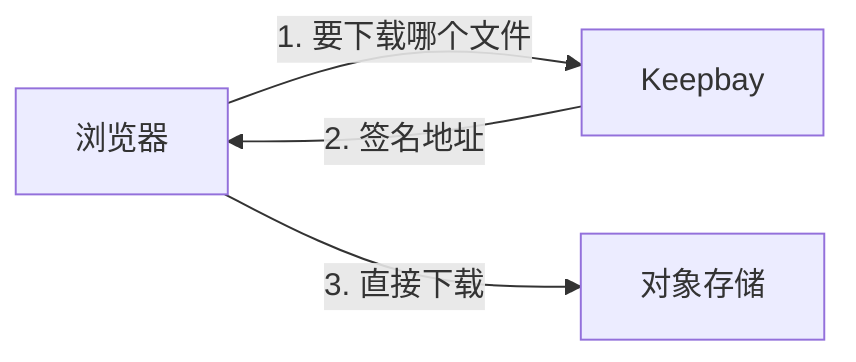

# 远程文件夹 {#remote-folders}

远程文件夹让 Keepbay 直接连接 S3 兼容的对象存储，比如 Cloudflare R2、阿里云 OSS，或者您自己架设的 MinIO。

文件存放在存储上，Keepbay 只保存索引和处理结果。浏览、搜索、上传下载、分享，和本机的文件夹用法一样。

远程文件夹是专业版的功能。

不想用专业版，或者要接的是网盘，也可以用 rclone 把它们同步或挂载到本地，见[云盘](./cloud-storage)。

## 支持的存储 {#providers}

现在支持 S3 兼容的对象存储：

- Amazon S3、Cloudflare R2
- 阿里云 OSS、腾讯云 COS、七牛云
- MinIO
- SeaweedFS、Garage、Ceph 等其他兼容 S3 的存储，服务商选"其他兼容 S3 的存储"

WebDAV、SFTP、OneDrive 以后会加上。

## 添加 {#add}

在「系统设置 › 存储」中点「添加文件夹」，位置选"远程存储"。

免费版在这里只显示一句说明和解锁的入口。

| 字段 | 说明 |
|---|---|
| 服务商 | 选好后预填地址格式、区域和路径风格 |
| 地址 | 存储的 S3 接口地址。自己架设的，写自己的地址，如 `http://192.168.1.10:9000` |
| 区域 | 按服务商填写，部分服务商可以从列表中选 |
| 存储桶 | 存储桶的名称 |
| 前缀 | 可以不填。填了只用存储桶中这个文件夹下的内容，如 `photos/2024` |
| 路径风格 | 地址写成"地址/存储桶"。自己架设的存储一般要打开 |
| 访问密钥 ID、访问密钥 | 存储的访问密钥，权限要求见[访问密钥](#keys) |

两家的地址容易填错：

Cloudflare R2 的地址在 Cloudflare 后台 R2 页面的 S3 API 中，里面有您的帐户 ID。

腾讯云 COS 的存储桶名称带 APPID，如 `photos-1250000000`。

显示名称、访问方式、补扫间隔、图标和本机的文件夹一样，见[文件夹](./folders#add)。远程文件夹另有[传输方式](#transfer)和[处理内容](#process)两项。

同一个存储桶中，前缀相同或者一个包含另一个的，不能重复添加。

### 测试连接 {#test}

填好后点「测试连接」。Keepbay 会在存储的 `.keepbay-probe/` 下写入、复制、删除几个临时对象，看看这个存储能做什么，结束后删掉。

点添加时会再测一次，不通过就不添加。

有的存储不支持"目标已存在就拒绝"的写入。Keepbay 靠它保证上传、改名时不会盖掉别的文件，没有就只能以只读方式添加。

测试结果中还可能列出这个存储的一些限制，比如改名、移动要复制再删除，比较慢。

上传到远程文件夹的单个文件最大 5 TB。存储不能保证分片上传不覆盖别的文件时，最大 5 GB，测试结果中会写明。

## 访问密钥 {#keys}

访问密钥要有存储桶（或前缀下）的列出、读取、写入、删除权限。只有读取权限的密钥，只能以只读方式添加。

建议在存储的控制台中为 Keepbay 单独建一个密钥，只给这个存储桶的权限。不用了直接删掉这个密钥，不影响别的程序。

密钥用数据目录中的 `secret.key` 加密保存，保存后不再显示。用备份恢复到新设备时，请把 `secret.key` 一起带过去，否则远程文件夹连不上，修改访问密钥也保存不了，只能移除后重新添加，见[隐私与安全](./privacy#encryption)。

添加后能改的只有访问密钥：在文件夹那一行的菜单中点「修改访问密钥」，整组重新填写，用新的密钥测试通过才保存。

服务商、地址、存储桶、前缀都不能改。要换的话，先移除，再重新添加。

移除只删除 Keepbay 中的索引，存储上的文件不受影响。和本机的文件夹一样，标签、AI 的处理结果、成员对这个文件夹的授权会一起删除，重新添加后要重新设置。

## 传输方式 {#transfer}

默认是"浏览器直连"：上传、下载单个文件、查看原图、播放视频和音频，都在浏览器和存储之间进行，不经过 Keepbay。

Keepbay 给浏览器的是一个有时效的签名地址，访问密钥始终只在服务器上。

有几样始终经过 Keepbay：缩略图存在 Keepbay 上；PDF、文本等文档的预览，多选或整个文件夹的打包下载，都由 Keepbay 从存储读出来再发给浏览器；上传时遇到重名、选了替换的，也经 Keepbay 中转。

直连要满足几个条件：

- 浏览器能访问存储的地址
- 存储桶允许本站来源的跨域请求：方法 GET、HEAD、PUT，请求头不限，暴露 `ETag`
- 用 https 打开 Keepbay 的，存储也要是 https
- 用公网域名打开 Keepbay、存储在局域网地址上的，Chrome 会拦下这种请求

跨域规则不用您手动去配。添加时、改为直连时，Keepbay 会尝试替您设置。

存储不支持、或者密钥没有这个权限时，页面上会说明。这时请按存储控制台的说明手动设置。

上传时直连不通的，比如跨域规则没设好、浏览器连不上存储，会自动改走中转，只是慢一些，经过 Keepbay 的流量多一些。查看原图、播放视频和音频时直连失败的，也会自动经 Keepbay 再试一次。

用 https 打开 Keepbay、存储是 http 的，下载也会直接改走中转。

其他情况下浏览器连不上存储，下载会失败。比如存储只在家里的局域网中，您在外面用手机打开 Keepbay。这时请在文件夹的设置中把传输方式改为"经 Keepbay 中转"，所有传输都经过服务器。

分享链接的访客也一样：直连时下载用签名地址。访客在线播放视频、音频时，一律经 Keepbay 中转。

## 处理内容 {#process}

远程文件夹默认只索引名称、大小和修改时间，不生成缩略图。

打开"处理内容"后，Keepbay 才会生成缩略图、提取文字、交给 AI、查找相同的文件。添加时可以打开，以后在文件夹的设置中也能改。

这些都要先把文件从存储上下载下来，会产生流量费。超过 2 GB 的文件不处理。

编辑图片、加水印也要先打开处理内容。

## 费用 {#cost}

存储按空间、流量、请求次数计费的，Keepbay 的读写同样会计费。用之前请看一下存储的价格。

删除的文件放在存储上的回收站 `.keepbay-trash/` 中，占用空间，照常计费。回收站的保留时间见[回收站和撤销](./trash#retention)。

对象存储上没有真正的改名。移入回收站、恢复、改名、移动，在存储上都是复制一份再删掉原来的，在后台进行。大文件夹比较慢，也会产生请求费。改名、移动、移入回收站、立即删除一次涉及 1 万个及以上的对象时，Keepbay 会先请您确认。

打开处理内容会多一笔下载流量，见[处理内容](#process)。

## 本机空间 {#local-space}

解压、离线下载到远程文件夹时，文件先暂存在 Keepbay 的数据目录中，完成后再上传到存储。经 Keepbay 中转的上传、存储内部不能直接复制的复制和移动，也一样要在本机暂存。浏览器直连的上传直接传到存储，不占本机空间。

打开了处理内容的，处理每个文件时也要先下载到本机的临时文件中，处理完删除。

所以数据目录所在的磁盘要留出足够的空间。往远程文件夹里离线下载一部 50 GB 的电影，本机就要有 50 GB 的空位。

中途中断的，会接着传。取消时，已经传过去的部分留在存储上。

## 发现变化 {#rescan}

远程存储没有变化通知。在 Keepbay 之外的改动，比如用存储的控制台或别的程序传的文件，靠定期补扫发现。

远程文件夹的补扫间隔默认 60 分钟，最短 15 分钟。等不及的话，点「立即扫描」。

每次补扫都要列一遍存储桶中的对象，按请求次数计费的存储，不要设得太短。

## 离线 {#offline}

连不上存储、认证失败、存储桶不存在时，文件夹显示离线和原因。

索引、标签、AI 结果都保留。存储恢复后，Keepbay 自动重新连接并补扫。

认证失败的，多半是密钥被删了或者过期了，直接在那一行点「修改访问密钥」。

## 专业版到期后 {#license}

专业版到期或者试用结束后，远程文件夹变为只读：可以浏览、搜索、下载，不能上传、改名、删除。

数据和索引都保留，重新激活后恢复。

这期间不能添加新的远程文件夹。
