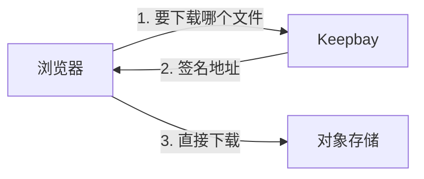

# 远程文件夹 <Badge type="tip" text="专业版" /> {#remote-folders}

远程文件夹让 Keepbay 直接连接 S3 兼容的对象存储，比如 Cloudflare R2、阿里云 OSS，或者您自己架设的 MinIO。

文件存放在存储上，Keepbay 只保存索引和处理结果。浏览、搜索、上传下载、分享，和本机的文件夹用法一样。

远程文件夹是专业版的功能。

如果不使用专业版，或者要接入的是网盘，可以用 rclone 把它们同步或挂载到本地，见[云盘](./cloud-storage)。

## 支持的存储 {#providers}

现在支持 S3 兼容的对象存储：

- Amazon S3、Cloudflare R2
- 阿里云 OSS、腾讯云 COS、七牛云
- MinIO
- SeaweedFS、Garage、Ceph 等其他兼容 S3 的存储，服务商选"其他兼容 S3 的存储"

WebDAV、SFTP、OneDrive 计划在后续版本中支持。

## 添加 {#add}

在「系统设置 › 存储」中点「添加文件夹」，位置选"远程存储"。

免费版在这里只显示一句说明和解锁的入口。

| 字段 | 说明 |
|---|---|
| 服务商 | 选好后预填地址格式、区域和路径风格 |
| 地址 | 存储的 S3 接口地址。自己架设的，写自己的地址，如 `http://192.168.1.10:9000` |
| 区域 | 按服务商填写，部分服务商可以从列表中选 |
| 存储桶 | 存储桶的名称 |
| 前缀 | 可以不填。填了只用存储桶中这个文件夹下的内容，如 `photos/2024` |
| 路径风格 | 地址写成"地址/存储桶"。自己架设的存储一般要打开 |
| 访问密钥 ID、访问密钥 | 存储的访问密钥，权限要求见[访问密钥](#keys) |

以下两家服务商的地址需要注意：

Cloudflare R2 的地址在 Cloudflare 后台 R2 页面的 S3 API 中，里面有您的帐户 ID。

腾讯云 COS 的存储桶名称带 APPID，如 `photos-1250000000`。

显示名称、访问方式、补扫间隔、图标和本机的文件夹一样，见[文件夹](./folders#add)。远程文件夹另有[传输方式](#transfer)和[处理内容](#process)两项。

同一个存储桶中，前缀相同或者一个包含另一个的，不能重复添加。

### 测试连接 {#test}

填好后点「测试连接」。Keepbay 会在存储的 `.keepbay-probe/` 下写入、复制、删除几个临时对象，检测这个存储支持哪些操作，结束后删除。

点添加时会再测一次，不通过就不添加。

有的存储不支持"目标已存在就拒绝"的写入。Keepbay 依靠这种写入保证上传、改名时不会覆盖其他文件，存储不支持时只能以只读方式添加，测试结果会提示"这个存储不支持安全写入"。

测试结果中还可能列出这个存储的一些限制，比如改名、移动要先复制再删除，速度较慢。

上传到远程文件夹的单个文件最大 5 TB。存储不能保证分片上传不覆盖其他文件时，最大 5 GB，测试结果中会写明。

## 访问密钥 {#keys}

访问密钥要有存储桶（或前缀下）的列出、读取、写入、删除权限。只有读取权限的密钥，只能以只读方式添加，测试结果会提示"访问密钥没有写入权限"。

建议在存储的控制台中为 Keepbay 单独建一个密钥，只给这个存储桶的权限。停止使用时删除这个密钥，不会影响其他程序。

密钥用数据目录中的 `secret.key` 加密保存，保存后不再显示。用备份恢复到新设备时，请把 `secret.key` 一并迁移，见[隐私与安全](./privacy#encryption)。缺少原来的 `secret.key` 时，远程文件夹显示离线，重新填写访问密钥后恢复，见[离线](#offline)。

添加后能改的只有访问密钥：在文件夹那一行的菜单中点「修改访问密钥」，整组重新填写，用新的密钥测试通过才保存。

服务商、地址、存储桶、前缀都不能改。如需更改，请先移除，再重新添加。

移除只删除 Keepbay 中的索引，存储上的文件不受影响。和本机的文件夹一样，标签、AI 的处理结果、成员对这个文件夹的授权会一起删除，重新添加后要重新设置。

## 传输方式 {#transfer}

默认是"浏览器直连"：上传、下载单个文件、查看原图、播放视频和音频，都在浏览器和存储之间进行，不经过 Keepbay。

Keepbay 给浏览器的是一个有时效的签名地址，访问密钥始终只在服务器上。

部分操作无论选择哪种传输方式都经过 Keepbay，比如打包下载和文档预览，见[流量走向](#traffic)。

直连需要满足以下条件：

- 浏览器能访问存储的地址
- 存储桶允许本站来源的跨域请求：方法 GET、HEAD、PUT，请求头不限，暴露 `ETag`
- 用 https 打开 Keepbay 的，存储也要是 https
- 存储在局域网地址上的，Keepbay 也要从局域网中打开。从公网打开时，浏览器无法连接这类存储，Chrome 也会阻止这类请求

跨域规则无需手动配置。添加文件夹或改为直连时，Keepbay 会尝试自动设置。

存储不支持、或者密钥没有这个权限时，页面上会说明。这时请按存储控制台的说明手动设置。

在 Keepbay 中上传、下载时如果直连失败，比如跨域规则未设置好、浏览器无法连接存储，这一次会自动改为经 Keepbay 中转，速度较慢，经过 Keepbay 的流量也更多。下载前，浏览器会先向存储读取 1 个字节，确认能连上再开始下载。

查看原图、播放视频和音频时直连失败的，也会自动经 Keepbay 再试一次。

以下情况 Keepbay 不尝试直连，直接改为中转：

- 用 https 打开 Keepbay，存储是 http：上传、下载、查看都经过 Keepbay
- 存储在局域网地址上，而 Keepbay 是从公网打开的，比如您在外面用手机访问，或者访客打开分享链接：下载、查看经过 Keepbay；上传仍先尝试直连，失败后改为中转

访客通过分享链接下载时，不做上面读取 1 个字节的确认。页面是 https 而存储是 http、存储在局域网而访客从公网打开，这两种情况以外，访客的浏览器无法连接存储时，下载会失败。

如果浏览器经常无法连接存储，建议在文件夹的设置中把传输方式改为"经 Keepbay 中转"，所有传输都经过服务器，不再每次先尝试直连。

## 流量走向 {#traffic}

**直连**：浏览器和存储之间直接传输，不经过 Keepbay。**经 Keepbay**：数据经过 Keepbay 所在的服务器，占用服务器的带宽。

从存储读出的数据，不论是否经过 Keepbay，存储一般都按流量计费。

### 浏览器和存储之间 {#traffic-browser}

这部分受[传输方式](#transfer)影响。

| 操作 | 选"浏览器直连"时 | 选"经 Keepbay 中转"时 | 本机暂存 |
|---|:---:|:---:|:---:|
| 上传 | 直连 [注&nbsp;1](#traffic-n1) | 经 Keepbay | 中转时 |
| 下载单个文件 | 直连 [注&nbsp;2](#traffic-n2) | 经 Keepbay | — |
| 打包下载（多选、整个文件夹） | 经 Keepbay | 经 Keepbay | — |
| 查看原图、播放视频和音频 | 直连 [注&nbsp;3](#traffic-n3) | 经 Keepbay | — |
| 预览 PDF、文本等文档 | 经 Keepbay | 经 Keepbay | — |
| 查看预览图（HEIC、相机 RAW、大图） | Keepbay 提供 [注&nbsp;4](#traffic-n4) | Keepbay 提供 [注&nbsp;4](#traffic-n4) | — |
| 显示缩略图 | Keepbay 提供 | Keepbay 提供 | — |
| 访客下载单个文件 | 直连 [注&nbsp;5](#traffic-n5) | 经 Keepbay | — |
| 访客在线播放视频、音频 | 经 Keepbay | 经 Keepbay | — |

### Keepbay 和存储之间 {#traffic-server}

这部分与传输方式无关。✓ 表示有，— 表示没有。

| 操作 | 从存储读取 | 写入存储 | 本机暂存 |
|---|:---:|:---:|:---:|
| 浏览文件列表、搜索 | — | — | — |
| 测试连接 | 少量 | 少量 | — |
| 补扫 | 只列出对象 [注&nbsp;6](#traffic-n6) | — | — |
| 生成缩略图、提取文字、交给 AI | ✓ [注&nbsp;7](#traffic-n7) | — | 临时文件 |
| 查找相同的文件 | ✓ [注&nbsp;8](#traffic-n8) | — | — |
| 编辑图片、批量加水印 | ✓ | ✓ | 临时文件 |
| 同一个远程文件夹中复制、改名、移动、移入回收站、恢复 | 存储内部完成 [注&nbsp;9](#traffic-n9) | 存储内部完成 | — |
| 跨文件夹复制、移动 [注&nbsp;10](#traffic-n10) | 来源是远程时 | 目标是远程时 | 目标是远程时 |
| 解压到远程文件夹 | 压缩包在远程时 | ✓ | ✓ |
| 离线下载到远程文件夹 | — | ✓ | ✓ |
| 立即删除、清空回收站 | — | 只发删除请求 | — |
| 撤销、重做 | [注&nbsp;11](#traffic-n11) | [注&nbsp;11](#traffic-n11) | [注&nbsp;11](#traffic-n11) |

### 注释 {#traffic-notes}

1. 直连不通时（跨域规则没设好、浏览器无法连接存储），自动改为经 Keepbay 中转。上传时遇到重名、选了替换的，也经 Keepbay 中转。
2. 下载前先读取 1 个字节确认能连上存储，连不上时这一次经 Keepbay 中转。页面是 https、存储是 http，或者存储在局域网而从公网打开 Keepbay 时，直接经 Keepbay。
3. 直连失败时，自动经 Keepbay 再试一次。
4. 第一次查看时从存储读取原文件，生成的预览图保存在 Keepbay 上，之后直接由 Keepbay 提供。
5. 分享设了限速或水印，页面是 https、存储是 http，或者存储在局域网而访客从公网打开时，经 Keepbay。其他情况下访客的浏览器无法连接存储时，下载会失败，不会自动改为中转。加了水印的图片，访客下载的是 Keepbay 生成的版本。
6. 只列出存储桶（或前缀）中的对象，不下载内容，存储按请求次数计费。
7. 打开[处理内容](#process)后才有。文件下载到本机的临时文件，处理完删除；缩略图和提取的文字保存在 Keepbay 上。
8. 打开处理内容后才有。64 MB 以内的文件完整读取后计算哈希，更大的只读开头、中间、结尾几段；发现可能相同时，再完整读取核对。
9. 由存储在内部复制，再删除原对象，数据不经过 Keepbay。存储不支持内部复制的、单个文件超过 5 GB 的，经 Keepbay 读出再写入。收件箱整理到远程文件夹也算移动。
10. 本机文件夹和远程文件夹之间、两个远程文件夹之间。同一个存储桶中不同前缀的两个远程文件夹，也算两个文件夹。目标是远程文件夹的，先在本机暂存，完整后再上传。
11. 按实际执行的操作计算。撤销改名、同一个远程文件夹中的移动，是在存储内部再移动一次。撤销跨文件夹的移动，是从来源的回收站中恢复原文件，再把目标处的副本移入回收站，不会重新传输文件。

## 处理内容 {#process}

远程文件夹默认只索引名称、大小和修改时间，不生成缩略图。

打开"处理内容"后，Keepbay 才会生成缩略图、提取文字、交给 AI、查找相同的文件。添加时可以打开，以后在文件夹的设置中也能改。

也可以只给其中一部分文件夹打开，这项设置只有所有者能看到。在远程文件夹中选中一个文件夹（不选时是当前所在的文件夹），信息面板中有"处理内容"一节，可以选"跟随上级""处理内容"或"只索引"。比如整个存储桶只索引，只给照片文件夹生成缩略图。

远程文件夹的根目录只有后两项，和「系统设置 › 存储」中的开关是同一个设置。

这些处理都需要先从存储下载文件，会产生流量费。超过 2 GB 的文件不处理。

编辑图片、加水印也要先打开处理内容。

## 费用 {#cost}

存储按空间、流量、请求次数计费的，Keepbay 的读写同样会计费。使用前请确认存储的计费标准。

删除的文件放在存储上的回收站 `.keepbay-trash/` 中，占用空间，照常计费。回收站的保留时间见[回收站和撤销](./trash#retention)。

对象存储不支持直接改名。移入回收站、恢复、改名、移动，在存储上都是先复制再删除原对象，在后台进行。大文件夹耗时较长，也会产生请求费。改名、移动、移入回收站、立即删除一次涉及 1 万个及以上的对象时，Keepbay 会先请您确认。

打开处理内容会多一笔下载流量，见[处理内容](#process)。每种操作的流量怎么走，见[流量走向](#traffic)。

## 后台操作 {#background}

远程文件夹中的改名、移入回收站、恢复、撤销、重做在后台进行，进度显示在右下角的[传输面板](./upload#transfers)中，按"已移 x / 共 y 个文件"显示，结束时提示结果。

移入回收站、恢复可以取消还没开始的项。改名、撤销、重做不能取消，文件夹开始移动后不会中途停下。

## 本机空间 {#local-space}

解压、离线下载到远程文件夹时，文件先暂存在 Keepbay 的数据目录中，完成后再上传到存储。经 Keepbay 中转的上传、存储内部不能直接复制的复制和移动，也一样要在本机暂存。浏览器直连的上传直接传到存储，不占本机空间。

打开处理内容后，处理每个文件时也要先下载到本机的临时文件中，处理完删除。

因此数据目录所在的磁盘需要预留足够的空间。例如向远程文件夹离线下载一部 50 GB 的电影，本机需要有 50 GB 的可用空间。

传输中断后会继续：已经传完的文件保留，没有传完的文件重新上传。取消时，已上传的文件保留在存储上。

## 发现变化 {#rescan}

远程存储没有变化通知。在 Keepbay 之外的改动，比如用存储的控制台或其他程序上传的文件，靠定期补扫发现。

远程文件夹的补扫间隔默认 60 分钟，最短 15 分钟。需要立即发现变化时，点「立即扫描」。

每次补扫都要列出存储桶（或前缀）中的对象。按请求次数计费的存储，不建议把间隔设得太短。

## 离线 {#offline}

无法连接存储、认证失败、存储桶不存在时，文件夹显示离线和原因。

索引、标签、AI 结果都保留。存储恢复后，Keepbay 自动重新连接并补扫。

认证失败有两种情况：存储拒绝了访问密钥（密钥已被删除、已过期，或没有读取权限），或者 Keepbay 无法解密保存的访问密钥（`secret.key` 丢失或更换过）。两种情况都在文件夹那一行点「修改访问密钥」，重新填写后恢复。

文件夹离线期间不能修改其中的内容，见[只读和离线的文件夹](./files#locked)。

## 专业版到期后 {#license}

专业版到期或者试用结束后，远程文件夹变为只读：可以浏览、搜索、下载，不能上传、改名、删除，见[只读和离线的文件夹](./files#locked)。

数据和索引都保留，重新激活后恢复。

这期间不能添加新的远程文件夹。
