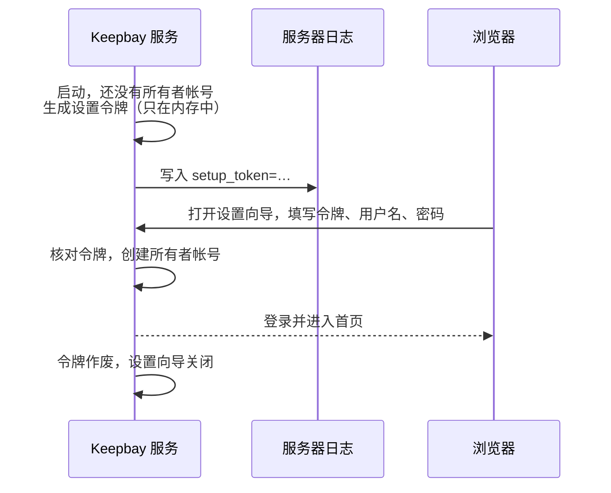

# 首次设置 {#setup}

安装完成后还需要两步：创建所有者帐号，再添加要管理的文件夹。

帐号可以在浏览器的设置向导中创建，也可以用 `keepbay setup` 在终端中创建，两种方式结果相同。

## 设置令牌 {#token}

Keepbay 默认监听所有网卡。如果任何人都能打开设置向导，同一网络中的其他人就可能抢先创建所有者帐号。

因此服务启动时会生成一个一次性的设置令牌，只有能查看服务器日志的人才能获取。在浏览器中创建帐号时必须输入它：



查看令牌的方法：

```bash
# 服务的日志
sudo journalctl -u keepbay | grep setup_token

# 或者直接取当前的令牌
sudo -u keepbay /opt/keepbay/keepbay setup:token
```

令牌只保存在服务的内存中，服务每次重启都会换一个新的。日志中可能有多个令牌，以最新的为准。

所有者帐号创建后，令牌作废，设置向导不再开放。

## 在浏览器中设置 {#browser}

在浏览器中打开 `http://<服务器地址>:8899`，设置向导只有一页：

| 字段 | 说明 |
|---|---|
| 设置令牌 | 见[上一节](#token) |
| 用户名 | 登录时使用。只能包含字母、数字和 `.` `_` `-`，以字母或数字开头，最长 32 个字符，大写字母会转为小写 |
| 显示名 | 显示在网页上，可以不填，默认同用户名 |
| 密码 | 至少 6 个字符 |
| 确认密码 | 再输入一次 |

点击「创建帐号」后直接登录。

## 在终端中设置 {#terminal}

`keepbay setup` 代替浏览器中的设置向导，在本机直接写入数据库，不需要设置令牌：

```bash
sudo /opt/keepbay/keepbay setup --user keepbay
```

依次询问：

1. **数据目录**：数据库、缩略图、设置放在这里，默认 `/var/lib/keepbay`。命令行写了 `--data-dir` 或设置了环境变量 `KEEPBAY_DATA_DIR` 时跳过这一项
2. **端口**：默认 `8899`，监听地址是 `0.0.0.0:<端口>`。端口被占用时会提示
3. **所有者的用户名、名称、密码**：规则同浏览器中的设置向导
4. **是否安装为系统服务**：默认安装，以 `--user` 指定的用户运行并立即启动；不安装时显示手动启动的命令

服务已经在运行时，只询问所有者帐号；已经完成设置时，提示"已经完成首次设置"。

在脚本中运行的写法见[命令行](./cli#setup)。

## 添加文件夹 {#add-folder}

所有者登录后，文件页提示还没有添加文件夹。在「系统设置 › 存储」中点击「添加文件夹」：

| 字段 | 说明 |
|---|---|
| 服务器上的路径 | 文件夹在服务器上的绝对路径，如 `/srv/photos` |
| 显示名称 | 显示在侧栏中，默认用文件夹名 |
| 访问方式 | 读写，或只读：只读时只读取和建立索引，不做任何写入，上传、移动、删除都不可用 |
| 定期补扫间隔 | 默认 360 分钟，可设 15 到 10080 分钟。本地磁盘上的改动实时监听；SMB、NFS 等网络挂载收不到通知，靠定期补扫发现 |

文件原样留在原处，Keepbay 只建立索引，不会移动或改动它们。

添加前请先给 `keepbay` 用户这个文件夹的权限：`sudo /opt/keepbay/keepbay mount:grant /srv/photos`，见[安装](./install#permissions)。如果没有授权，添加时页面会显示填好路径的这条命令，可以直接复制。只能读取的文件夹，没有手动选过访问方式时会自动选为只读，需要读写时按页面上的命令授权。

::: tip 先用只读方式试用
不确定时可以先以只读方式添加，看过浏览、搜索的效果后，再在这个文件夹的「修改设置」中改为读写。
:::

添加后 Keepbay 在后台扫描文件夹：先建立文件列表（这时已经可以浏览和按文件名搜索），再识别内容、生成缩略图、提取文字。

文件较多时需要一段时间。进度显示在侧栏的后台任务中，也可以用 `keepbay index:status` 查看。各阶段的细节见[技术架构](./architecture#pipeline)。

## 下一步 {#next}

完成以上两步即可开始使用。之后可以按需进行以下设置：

如需从外网访问，请按[外网访问](./remote-access)配置 Tailscale 或反向代理，不要把 8899 端口直接开放到公网。

在「个人设置 › 安全」中开启两步验证或添加通行密钥，尤其是所有者帐号。

如果家庭成员也要使用，请在「系统设置 › 家庭成员」中添加成员，再把文件夹授权给他们，只读或读写。免费版最多 2 个用户（含所有者）。

专业版用户可以在「系统设置 › AI 模型」中下载本地模型，或者添加 AI 厂商。在此之前，建议先阅读[隐私与安全](./privacy)，了解哪些数据会离开您的设备。
