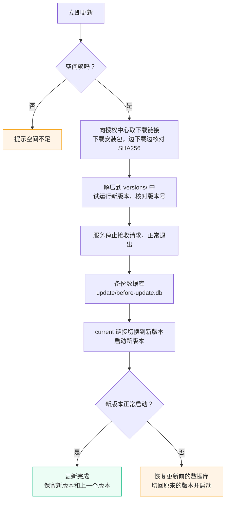

# 升级 {#upgrade}

Keepbay 每天检查一次新版本，有了就通知所有者，不会自动安装，什么时候更新由您决定。按[安装](./install#layout)中的布局安装的，在网页上点一下就能更新：先备份数据库，服务重新启动约一分钟；新版本没能正常启动时，自动回到原来的版本。

## 检查更新 {#check}

服务启动 3 分钟后第一次检查，之后每 24 小时检查一次（失败时 1 小时后重试）。检查的请求发给授权中心 `huohuastudio.com`，**只发送产品名称和是否接收测试版**，不发送授权码、安装 ID 或这台设备的任何信息。

发现新版本时会通知所有者，每个版本只通知一次。不想让它每天检查的，在「系统设置 › 维护」中关闭「每天自动检查」，之后只在您点「检查更新」时才查询。

正在用测试版（版本号带 `alpha`、`beta`、`rc`）的，会收到之后的测试版和正式版；正在用正式版的只会收到正式版，不会被拉进测试。

也可以在终端中检查：

```bash
sudo -u keepbay /opt/keepbay/keepbay update:check
```

## 在线更新 {#online}

在「系统设置 › 维护」中可以看到新版本的更新说明，点击「立即更新」并输入所有者密码确认（用支持重新验证的外部帐号登录的，5 分钟内重新验证过即可；GitHub 帐号不支持，仍要输入密码）。也可以在终端中运行：

```bash
sudo -u keepbay /opt/keepbay/keepbay update
```

更新的过程：



开始前会先看空间够不够：安装目录要有安装包 4 倍以上的空间，数据目录要有数据库大小以上的空间。下载链接是向授权中心换来的，只有这一步会发送安装 ID。

服务重新启动期间大约一分钟不能使用，网页上会显示进度，完成后自动刷新。新版本启动失败或健康检查不通过时，Keepbay 恢复更新前的数据库、回到原来的版本，并在「系统设置 › 维护」中告诉您"更新到 X 失败，已回到 Y"。每一步的状态都写在数据目录的 `update/` 中，更新到一半停电了也不怕，下次启动接着完成或者回滚。

更新完成后，`versions/` 中保留新版本和上一个版本，更早的自动删除。

### 不能在网页上更新的情况 {#blocked}

| 提示 | 处理 |
|---|---|
| 安装目录是 0.1.0-beta 的安装方式 | 0.1.0-beta.3 之前的版本程序直接放在 `/opt/keepbay` 中，按[从早期内测版升级](#from-early-beta)手动升级一次 |
| 运行服务的用户不能写入安装目录 | 运行页面上给出的 `sudo chown -R keepbay: /opt/keepbay` 后刷新，或者按[手动升级](#manual)操作 |

## 手动升级 {#manual}

安装目录不属于 `keepbay` 用户、不想让程序修改安装目录时，手动升级。

::: tip 专业版的更新服务期
专业版含 1 年更新服务。服务期结束后发布的功能版本，手动装上后专业版功能会暂停（修补版不受影响），网页上的检查更新也不会推荐这类版本。手动升级前请先确认目标版本在服务期内，或者先续费。
:::

```bash
sudo tar -xzf keepbay_<新版本>_linux_amd64.tar.gz -C /opt/keepbay/versions --no-same-owner
sudo ln -sfn versions/keepbay_<新版本>_linux_amd64 /opt/keepbay/current
sudo systemctl restart keepbay
```

新版本启动时如果需要升级数据库，会先在 `backups/` 中备份，见[数据库升级](#database)。有问题时把 `current` 指回原来的版本：

```bash
sudo systemctl stop keepbay
sudo ln -sfn versions/keepbay_<原版本>_linux_amd64 /opt/keepbay/current
# 数据库已经升级过时，要用升级前的备份恢复，旧版本打不开新版本的数据库
sudo -u keepbay /opt/keepbay/keepbay db:restore /var/lib/keepbay/backups/pre-migrate-<时间>-v<版本>.db
sudo systemctl start keepbay
```

手动升级不会自动删除旧版本，确认新版本正常后可以删除 `versions/` 中不再需要的目录。

## 数据库升级 {#database}

新版本可能需要升级数据库的结构，在启动时自动完成：

1. 启动时发现有待执行的升级
2. 先用 `VACUUM INTO` 把数据库备份为 `backups/pre-migrate-<时间>-v<原版本>.db`，这类备份只保留最近 3 份
3. 执行升级。失败时服务不会启动，原来的数据可以用这份备份恢复

数据库只能升级、不能降级：用旧版本打开升级过的数据库时会提示"数据库版本比程序支持的版本新"。要退回旧版本，需要同时用升级前的备份恢复数据库，这之后在新版本中做的改动（如新加的标签）会丢失，您的文件不受影响。

## 从早期内测版升级 {#from-early-beta}

0.1.0-beta.1、0.1.0-beta.2 的程序直接放在 `/opt/keepbay` 中，不能在网页上更新。按下面的步骤换成新的布局，只需要做一次：

```bash
sudo systemctl stop keepbay
sudo mv /opt/keepbay /opt/keepbay.old

# 按安装页的第 1 步解压新版本、建两个链接
sudo mkdir -p /opt/keepbay/versions
sudo tar -xzf keepbay_<版本>_linux_amd64.tar.gz -C /opt/keepbay/versions --no-same-owner
sudo ln -sfn versions/keepbay_<版本>_linux_amd64 /opt/keepbay/current
sudo ln -sfn current/keepbay /opt/keepbay/keepbay
sudo chown -R keepbay: /opt/keepbay

sudo systemctl start keepbay
```

服务文件中的路径 `/opt/keepbay/keepbay` 没有变（现在是指向新版本的链接），不用重新安装服务。确认正常后删除 `/opt/keepbay.old`。

::: warning 端口仍是 8790
早期内测版的默认端口是 8790，现在是 8899。端口写在服务文件中，升级不会改变。想换成 8899 时重新安装服务，并相应调整防火墙和反向代理：

```bash
sudo /opt/keepbay/keepbay service:install --user keepbay --data-dir /var/lib/keepbay --listen 0.0.0.0:8899
```

重新安装不会沿用原来服务文件中的参数，数据目录不在默认位置的，`--data-dir` 写您自己的。

用 `systemctl edit` 添加的环境变量（如可信代理）在单独的文件中，重新安装服务不会清除。
:::
