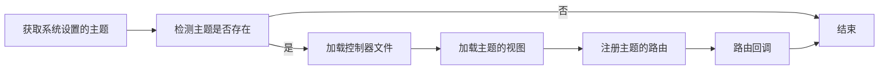
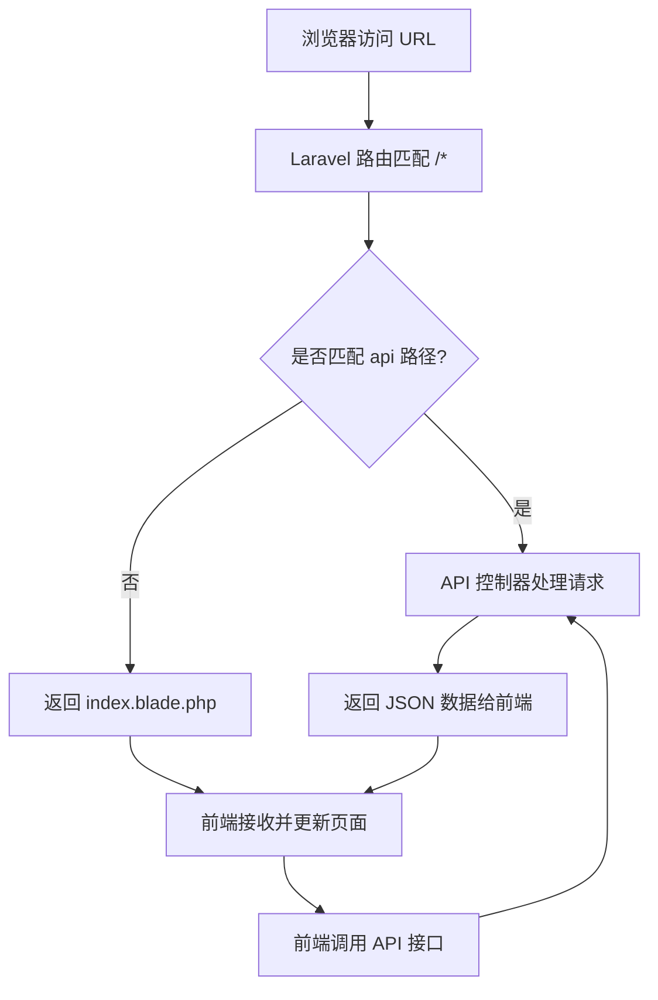

# 主题 {#theme}

主题决定前台（用户访问的页面）的外观，管理后台不受主题影响。可以安装他人开发的主题，也可以自己开发：主题可以是用 Laravel Blade 渲染的普通页面，也可以是调用接口的单页应用（SPA）。内置的默认主题就是一个用 Vue 3 开发的单页应用。

开发主题需要熟悉 [Laravel](https://laravel.com)、[Blade 模板](https://laravel.com/docs/12.x/blade) 和用于构建配置表单的 [Filament](https://filamentphp.com)。修改默认主题还需要熟悉 [Node.js](https://nodejs.org)、[Vite](https://cn.vitejs.dev)、[Vue 3](https://cn.vuejs.org)、[Pinia](https://pinia.vuejs.org/zh)、[Vue Router](https://router.vuejs.org)、[Naive UI](https://www.naiveui.com) 和 [Tailwind CSS](https://tailwindcss.com)。

## 安装主题 {#install-theme}

[主题](../../themes)页面列出了已收录的主题。安装主题有两种方式：

- **上传到 `themes` 目录**：把主题文件夹上传到程序根目录的 `themes` 目录中。使用 Docker 安装时，放到映射的 `themes` 目录（见[Docker 容器启动](../guide/install#docker-container)）
- **在后台导入**：在管理后台的「主题管理」页面，点击「导入主题」按钮，上传主题的 zip 压缩包

安装后，在「主题管理」页面的「选择主题」中选择这个主题，按需填写主题配置，点击「保存」即可启用。

### 在后台导入主题 {#import-theme}

主题中包含 PHP 代码，导入主题等同于在服务器上执行代码，因此从 2.5.1 起「导入主题」默认禁用。需要在线导入时：

1. 在程序根目录的 `.env` 文件中设置：

   ```bash
   APP_THEME_IMPORT_ENABLED=true
   ```

2. 如果执行过 `php artisan optimize` 或 `php artisan config:cache`，再执行 `php artisan config:clear` 使设置生效
3. 导入完成后，建议把这一项改回 `false`

压缩包中需要包含主题入口类文件（`*Theme.php`），可以直接放在压缩包根目录，也可以放在压缩包中唯一的文件夹里。已经存在同名主题时，需要勾选「覆盖已有主题」才能导入。

:::danger
请只安装来源可信的主题。主题中的 PHP 代码拥有和程序相同的权限，可以读取数据库和服务器上的文件。
:::

在「主题管理」页面还可以导出主题（打包为 zip）和删除主题。删除会删除主题的所有文件，并自动切回默认主题；内置的默认主题不能删除。

## 主题是如何运作的？ {#theme-works}

程序从两个位置读取主题：

- `app/Themes/`：内置主题（默认主题）
- `themes/`：第三方主题和自己开发的主题

一个主题的目录结构如下：

```
my-test/                    # 主题文件夹，名称与主题 id 保持一致
 ├─ assets/                 # 静态资源目录
 │  ├─ css/
 │  ├─ fonts/
 │  ├─ images/
 │  └─ js/
 ├─ controllers/            # PHP 控制器目录（可选）
 │  └─ YourController.php
 ├─ views/                  # 视图，文件名以 .blade.php 结尾
 │  ├─ components/
 │  │  └─ button.blade.php
 │  ├─ layouts/
 │  │  └─ app.blade.php
 │  └─ pages/
 │     └─ index.blade.php
 ├─ README.md               # 主题说明
 └─ MyTestTheme.php         # 主题入口类
```

程序根据文件夹名称推导入口类的类名和命名空间：文件夹 `my-test` 对应命名空间 `Themes\MyTest`、入口文件 `MyTestTheme.php`。启用主题后，程序会把 `public/assets` 链接到当前主题的 `assets` 目录，页面中用 `/assets/...` 引用静态资源。

### 主题入口类 {#entrance}

入口类继承 `App\Contracts\ThemeAbstract`，用属性声明主题信息，并实现以下方法：

- **`configurable()`**：必须实现，返回后台「主题管理」中的配置表单，见 [configurable 方法](#configurable)
- **`routes()`**：定义主题的路由，见 [routes 方法](#routes)
- **`casts()`**：可选，转换配置值，见 [casts 方法](#casts)

```php
<?php

namespace Themes\MyTest;

use App\Contracts\ThemeAbstract;
use Filament\Forms\Components\Textarea;
use Filament\Forms\Components\TextInput;
use Filament\Schemas\Components\Section;
use Illuminate\Support\Facades\Route;

class MyTestTheme extends ThemeAbstract
{
    /** @var string 主题唯一标识，与文件夹名称一致 */
    public string $id = 'my-test';

    /** @var string 主题名称，显示在管理后台中 */
    public string $name = '测试主题';

    /** @var string|null 主题描述 */
    public ?string $description = '这是一个测试主题';

    /** @var string 主题作者 */
    public string $author = 'Unknown';

    /** @var string 主题版本 */
    public string $version = '1.0.0';

    /** @var string|null 主题官网或仓库地址 */
    public ?string $url = '';

    /**
     * 主题路由
     */
    public function routes(): void
    {
        Route::get('/', fn () => view("{$this->id}::pages.index"));
    }

    /**
     * 后台配置表单
     */
    public function configurable(): array
    {
        return [
            Section::make('基础设置')->schema([
                TextInput::make('payload.site_title')
                    ->label('网站标题')
                    ->maxLength(100)
                    ->required(),
                Textarea::make('payload.site_description')
                    ->label('网站描述')
                    ->maxLength(500)
                    ->rows(3),
            ]),
        ];
    }

    /**
     * 配置值转换
     */
    public function casts(): array
    {
        return [];
    }
}
```

### 生命周期 {#lifecycle}



主题的配置可以在 Blade 视图中通过 `ThemeService` 读取，`getTheme()` 的参数是主题 id：

- 读取某一项：`\App\Facades\ThemeService::getTheme('my-test')->getSettings('site_title')`
- 读取全部：`\App\Facades\ThemeService::getTheme('my-test')->getSettings()`

单页应用主题可以请求 `GET /api/v2/configs` 接口，返回的 `data.site` 中是当前主题的全部配置。

### routes 方法 {#routes}

::: tip
Laravel 路由的详细用法见 [Laravel 官方文档](https://laravel.com/docs/12.x/routing)。
:::

在 `routes` 方法中定义主题的路由：

```php
<?php

use Illuminate\Support\Facades\Route;
use Themes\MyTest\Controllers\YourController;

public function routes(): void
{
    // 访问首页时直接返回视图
    Route::get('/', fn () => view("{$this->id}::pages.index"));

    // 也可以交给控制器处理
    Route::get('/about', [YourController::class, 'about']);

    // 单页应用：除 /api 开头以外的所有路径都交给同一个入口
    // Route::any('/{any}', [YourController::class, 'index'])->where('any', '^(?!api).*');
}
```

### casts 方法 {#casts}

配置表单中有文件上传字段（例如 logo）时，保存的配置值只是文件路径，不是完整的网址。可以在 `casts` 中转换读取时的值：

```php
<?php

use App\Support\Attribute;
use Illuminate\Support\Facades\Storage;

public function casts(): array
{
    return [
        'logo' => new Attribute(
            // 读取时把文件路径转换为完整网址
            get: fn ($value) => $value ? Storage::url($value) : '',
        ),
    ];
}
```

`getSettings()` 返回转换后的值；需要原始值时使用 `getRawSettings()`。

### configurable 方法 {#configurable}

`configurable` 返回后台「主题管理」中的配置表单，使用 [Filament](https://filamentphp.com/docs/4.x) 的组件构建，常用的是：

- [Filament Forms](https://filamentphp.com/docs/4.x/forms/overview)：输入框、选择框、文件上传等表单字段
- [Filament Schemas](https://filamentphp.com/docs/4.x/schemas/overview)：分组、栅格等布局组件

所有表单字段的名称都必须以 `payload.` 开头，例如网站标题的配置项名称为 `payload.title`，读取时使用 `title`。最简单的配置表单：

```php
<?php

use Filament\Forms\Components\TextInput;

public function configurable(): array
{
    return [
        // TextInput 组件文档：https://filamentphp.com/docs/4.x/forms/text-input
        TextInput::make('payload.title')
            ->label('网站标题')
            ->maxLength(60)
            ->required(),
    ];
}
```

在「主题管理」中选择这个主题后，就会出现「网站标题」配置项。

## 创建新的主题 {#create-theme}

程序内置了生成主题模板的命令，在程序根目录执行：

```shell
php artisan make:theme
```

按提示填写主题 id（小写字母、数字和 `-`，3 到 30 个字符）、名称、作者、描述，选择是否创建 `assets`、`views`、`controllers` 目录和配置表单的模板类型，命令会在 `themes/` 目录中生成主题模板。在此基础上修改即可。

开发完成后，可以提交到主题仓库，见[主题](../../themes#submit)页面。

## 修改默认主题 {#edit-default-theme}

默认主题是混合部署的单页应用：Laravel 用通配路由把除 `/api` 以外的所有请求都交给主题入口，返回单页应用的 `index.blade.php`；页面在浏览器中渲染后，再调用 `/api` 开头的接口获取数据。因此不需要额外的伪静态规则，刷新页面也不会出现 404。



默认主题的源码在安装包的 `web` 目录中。Docker 镜像中没有这个目录，需要时请在授权中心下载与当前版本相同的安装包取得。修改前请在电脑上安装 [Node.js](https://nodejs.org) 22.13 或以上版本。

在 `web` 目录中安装依赖：

::: code-group

```shell [npm]
npm install
```

```shell [Yarn]
yarn
```

:::

启动开发服务器，修改代码后页面会自动刷新：

::: code-group

```shell [npm]
npm run dev
```

```shell [Yarn]
yarn dev
```

:::

开发服务器默认请求 `http://127.0.0.1:8000/api/v2` 的接口，可以修改 `web/.env` 中的 `VITE_APP_API_URL` 指向您的站点。

修改完成后执行构建：

::: code-group

```shell [npm]
npm run build
```

```shell [Yarn]
yarn build
```

:::

构建结果会直接写入程序的 `app/Themes/Default` 目录（`assets`、`views/index.blade.php` 和 `DefaultTheme.php`），把这个目录上传到服务器覆盖即可。

:::warning
默认主题属于程序文件。升级时如果新版本修改了默认主题，您的修改会被覆盖；「修复安装」也会把它恢复为官方文件。请保留修改过的源码，升级后用新版本的 `web` 目录合并修改并重新构建。需要长期维护的修改，建议做成独立的主题放在 `themes` 目录中。
:::
