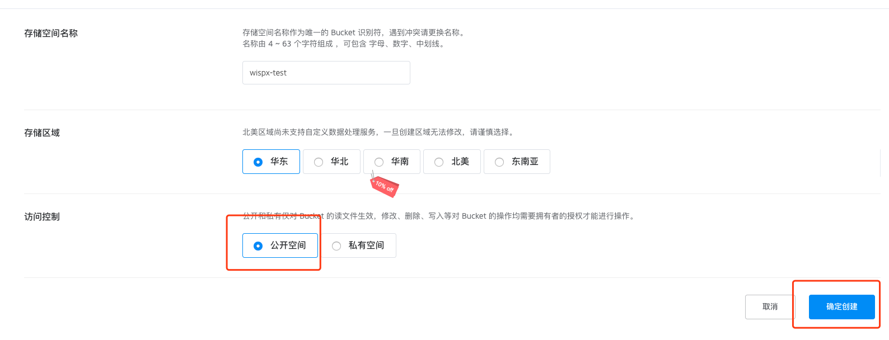
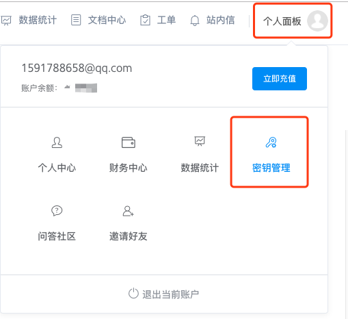
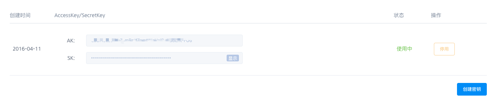
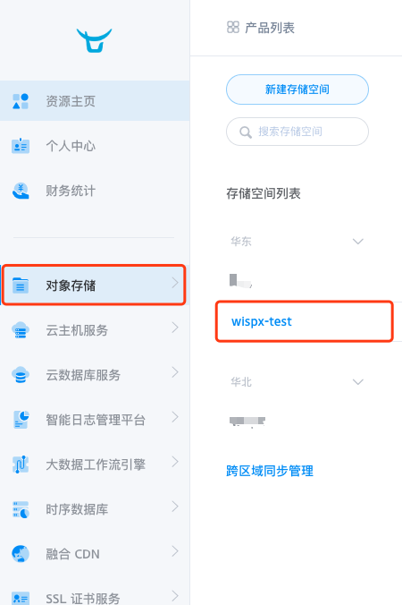
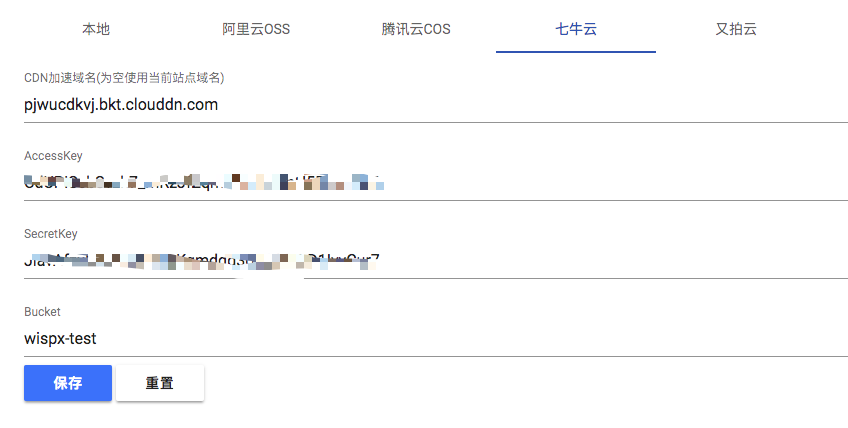

# 七牛云KODO

七牛云对象储存申请地址：[https://www.qiniu.com/products/kodo](https://www.qiniu.com/products/kodo)

申请后进入对象储存控制台，点击“新建储存空间”。

注意访问控制选项选择公开空间，然后点击确定创建。

创建后我们先待定，鼠标点击右上角“个人面板”，然后点击“密钥管理”。

然后获取到你的AK(AccessKey)和SK(SecretKey)并保存下来，如果没有请创建密钥。

保存后我们回到对象储存，点击你刚刚创建的储存空间。

然后在右侧你可以看到储存空间默认的测试域名，该域名仅用于测试，从创建空间起开始，30天

后自动回收，墙裂建议你绑定自定义域名。

让我们在回到Lsky Pro后台管理->储存策略->七牛云，填写相应的配置信息，如下图

加速域名如果不加访问协议，默认使用的是http，你也可以在域名前加上协议，例如：https://域名。(https前提条件是你的域名正确的配置了SSL证书)

填写完毕后点击保存即可。