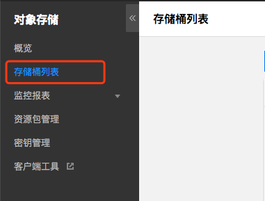
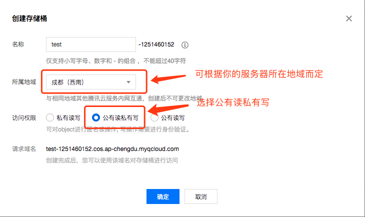
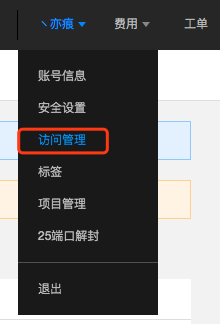
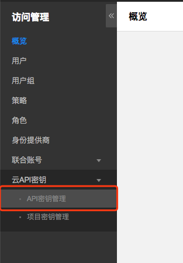
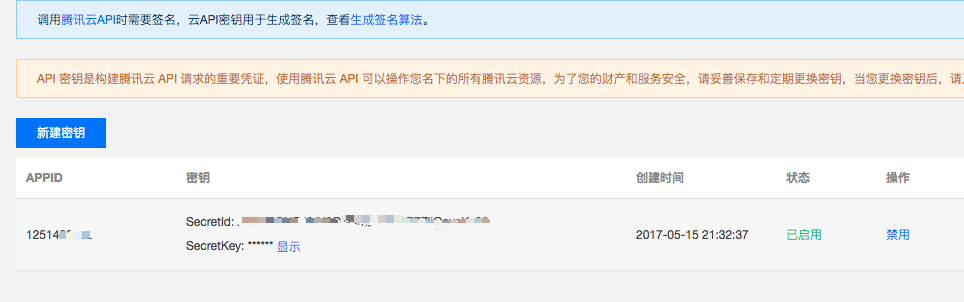
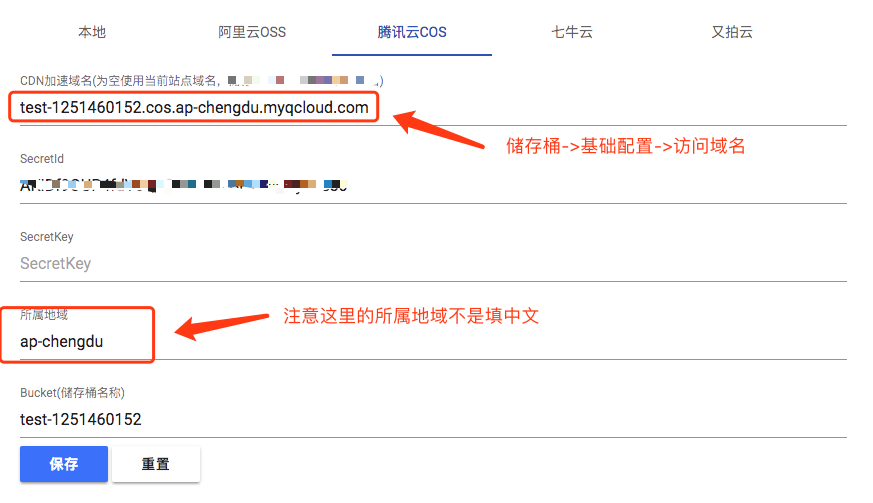

# 腾讯云COS

腾讯云对象储存COS申请地址：[https://cloud.tencent.com/product/cos](https://cloud.tencent.com/product/cos)

申请了腾讯云对象储存COS以后，进入对象储存控制台，然后点击储存桶列表，如下图：

然后点击创建储存桶

注意访问权限需要选择公有读私有写

创建成功后我们先暂放，鼠标悬浮右上角的昵称，点击访问管理。

然后会在左侧导航栏看到“云API密钥” -> “API密钥管理”，点击进去。

进去后会有一个高风险提示，请选择继续使用，然后你会看到你的API密钥(如果没有请新建)，点击显示获取SecretKey，如下图：

获取到后请复制保存下来。

然后我们在回到储存桶列表，点击进入你刚刚创建的储存桶，再点击“域名管理”，复制储存桶的访问域名。

这时候我们在打开Lsky Pro后台管理->储存策略->腾讯云COS

填写配置如图：

如果你绑定了自定义域名，这里的CDN加速域名请填写你绑定的域名，如果不加访问协议，默认使用的是http，你也可以在域名前加上协议，例如：https://域名。(https前提条件是你的域名正确的配置了SSL证书)

填写完毕后点击保存即可。