# 支付驱动 {#payment}

支付驱动用于用户购买套餐时在线付款。目前支持 6 种：支付宝、微信、银联、PayPal、EPay（易支付）、Stripe。

在管理后台的「支付」页面，点击「新建」按钮创建支付驱动，然后在[角色组](./group#basic)的「支付驱动」中勾选，该组的用户下单时才能使用。

## 回调地址 {#callback-url}

支付平台通过回调通知程序付款结果，回调地址的格式为 `站点域名/api/v2/payment/callback/驱动 ID/订单号`：

- **支付宝、微信、银联、EPay**：程序下单时自动把回调地址传给支付平台，不需要在支付平台后台填写
- **PayPal、Stripe**：需要在支付平台后台创建 Webhook，地址为 `站点域名/api/v2/payment/callback/驱动 ID`。保存驱动后，编辑页会显示完整的「Webhook 地址」，直接复制即可

:::warning
回调地址按用户下单（或管理员打开编辑页）时访问的域名和协议生成。请确保站点能从公网访问；使用反向代理时，请按[常见问题](./faq#https-reverse-proxy-static-links-http)传递 `X-Forwarded-Proto` 等请求头，否则生成的地址可能是 `http://` 或内网地址，付款后订单不会变为已支付。
:::

## 支付宝 {#alipay}

支持电脑网站支付，用户在手机上下单时自动改为跳转支付宝 H5 支付。只支持证书模式（公钥证书），不支持普通公钥模式。

「模式」可选正常模式、沙箱模式、服务商模式。

### 创建支付应用 {#alipay-create-payment-app}

在支付宝开放平台的[创建应用](https://open.alipay.com/develop/pm/create)页面，创建网页移动应用。

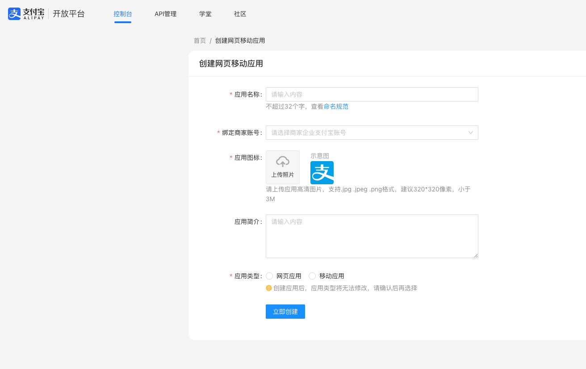

### 绑定支付宝支付产品 {#alipay-bind-product}

进入应用，点击「产品绑定」，选择「支付」→「电脑网站支付」。

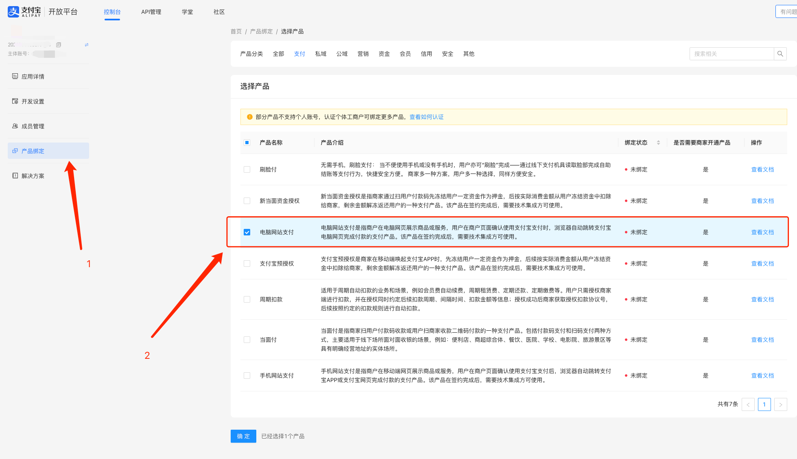

### 开通电脑网站支付 {#alipay-open-website-pay}

绑定后，如果「产品开通状态」显示「未开通」，请按支付宝的指引开通，否则无法收款。用户在手机上下单时使用的是「手机网站支付」，请用同样的方法绑定并开通这一项，否则手机上无法付款。

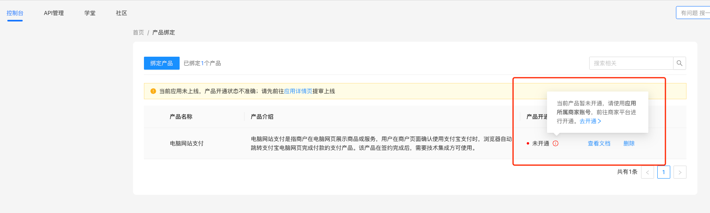

### 设置加签方式 {#alipay-set-encrypt-method}

在应用的开发设置中设置接口加签方式，选择第二项「证书」。

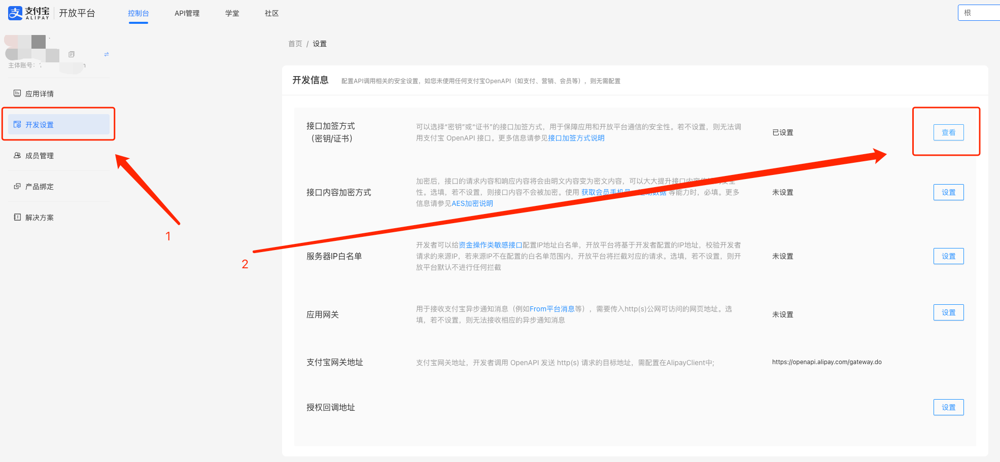
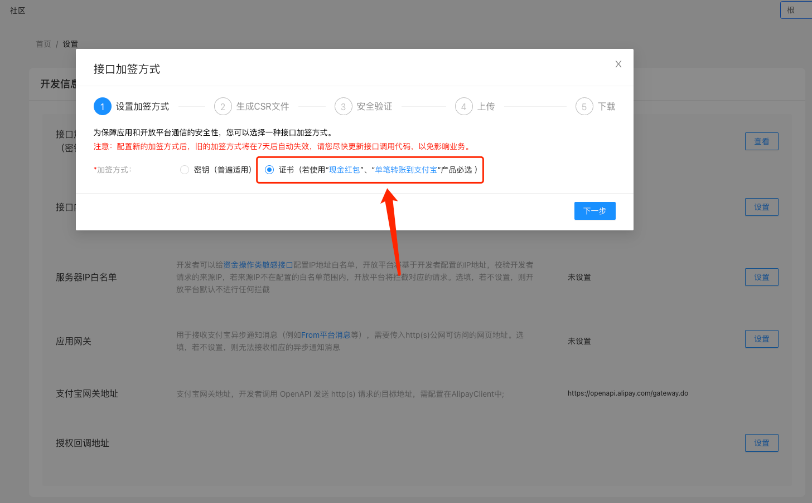

### 下载证书生成软件 {#alipay-certificate-software}

按页面提示下载支付宝开放平台密钥工具。

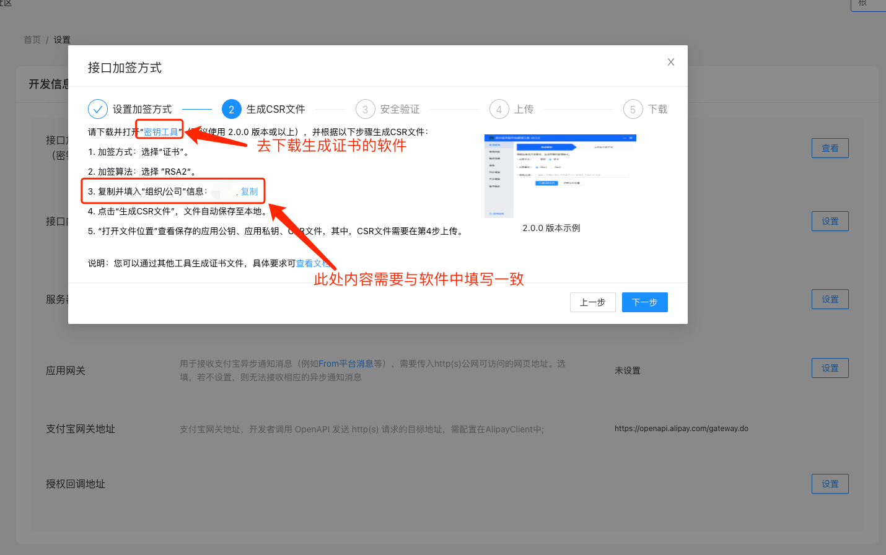

### 生成证书并上传 {#alipay-generate-certificate}

用密钥工具生成证书签名请求（CSR）文件，上传到开放平台。

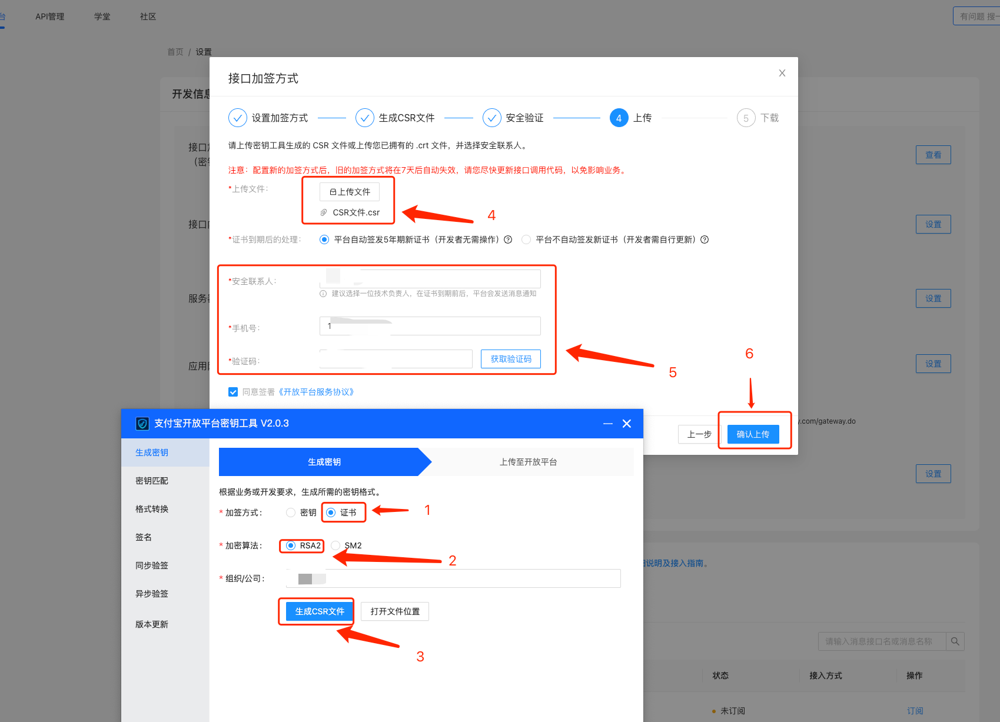

### 下载证书 {#alipay-download-certificate}

上传成功后，下载全部三个证书：应用公钥证书、支付宝公钥证书、支付宝根证书。

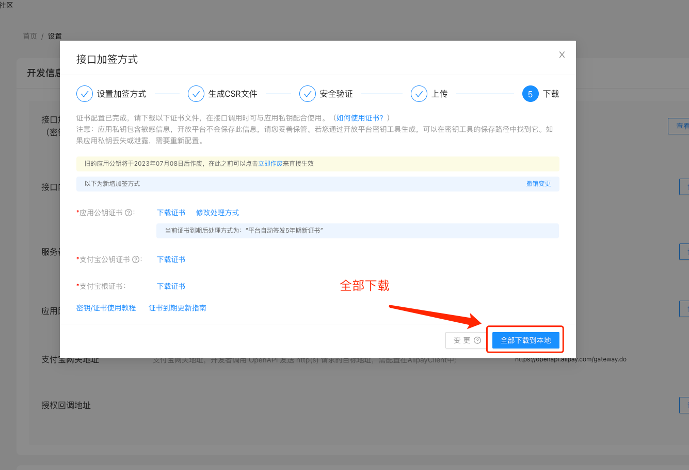

### 设置回调地址 {#alipay-callback-url}

付款结果的通知地址由程序在下单时自动传给支付宝，不需要在开放平台中填写，见[回调地址](#callback-url)。

### 上传证书 {#alipay-upload-certificate}

在图床后台创建支付宝驱动，填写：

| 字段 | 说明 |
|---|---|
| App ID | 应用的 App ID |
| 应用私钥证书 | 打开密钥工具生成的 `应用私钥RSA2048-敏感数据，请妥善保管.txt`，复制其中的内容 |
| 应用公钥证书 | 上传 `appCertPublicKey_xxx.crt` |
| 支付宝公钥证书 | 上传 `alipayCertPublicKey_RSA2.crt` |
| 支付宝根证书 | 上传 `alipayRootCert.crt` |
| 第三方应用授权 token | 选填 |
| 服务提供者 ID | 选填，服务商模式时必填 |

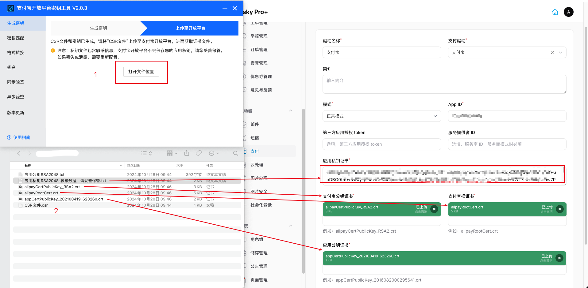

## 微信 {#wechat}

支持微信 Native 支付（用户扫码付款），使用 APIv3 接口和微信支付公钥验签。「模式」可选正常模式、服务商模式。

准备以下内容（密钥和证书在微信支付商户平台的「账户中心」→「API 安全」中），然后在图床后台创建微信驱动：

| 字段 | 说明 |
|---|---|
| 商户号 | 服务商模式下填写服务商的商户号 |
| 商户密钥（V3） | 在「API 安全」中设置的 APIv3 密钥 |
| 商户密钥（V2） | 选填 |
| 商户私钥证书 | 上传申请 API 证书得到的 `apiclient_key.pem` |
| 商户公钥证书 | 上传 `apiclient_cert.pem` |
| 微信平台公钥证书 ID | 在「API 安全」中查看，形如 `PUB_KEY_ID_` 开头的字符串 |
| 微信平台公钥证书 | 上传微信支付公钥文件 |
| 公众号 App ID | 必填，与商户号绑定的公众号（或服务号）的 App ID。扫码支付下单时使用这一项，留空会导致无法下单 |

小程序、App 的 App ID 不用填写。服务商模式下还必须填写「子商户号」；子商户使用自己的公众号时，填写「子公众号 App ID」。

## 银联 {#unipay}

对接银联条码支付综合前置平台，用户扫码付款。需要填写：

| 字段 | 说明 |
|---|---|
| 商户号 | 银联分配的商户号 |
| 商户密钥 | 在银联平台中配置的商户密钥 |
| 商户公私钥 | 上传 `.pfx` 格式的商户证书 |
| 商户公私钥密码 | 商户证书的密码 |
| 银联公钥证书 | 上传银联中级证书（`acp_prod_middle.cer`）或银联签名证书 |

:::warning
银联公钥证书用于校验回调的签名，没有上传时程序会拒绝所有回调，付款后订单不会变为已支付。
:::

## PayPal {#paypal}

### 创建应用 {#paypal-create-application}

在 PayPal 开发者中心点击「Create App」创建应用（下图为沙箱环境）。

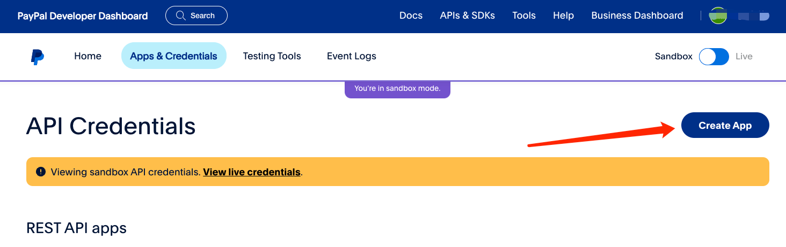

「Type」选择「Merchant」，点击「Create App」确认创建。

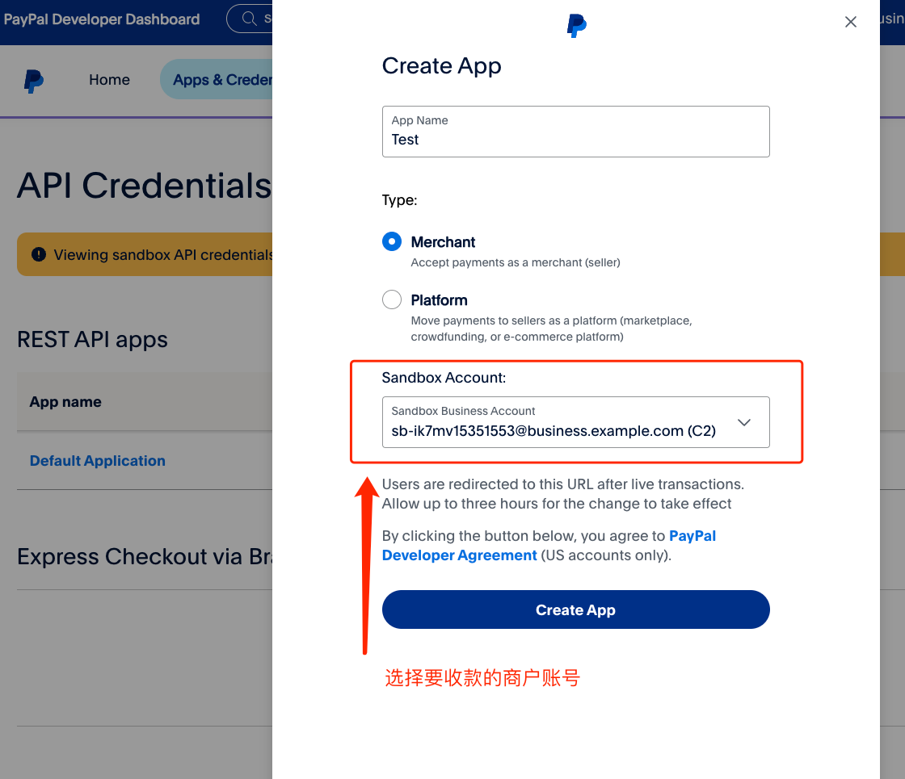

### 配置 {#paypal-configuration}

在应用详情中复制 Client ID 和 Secret。

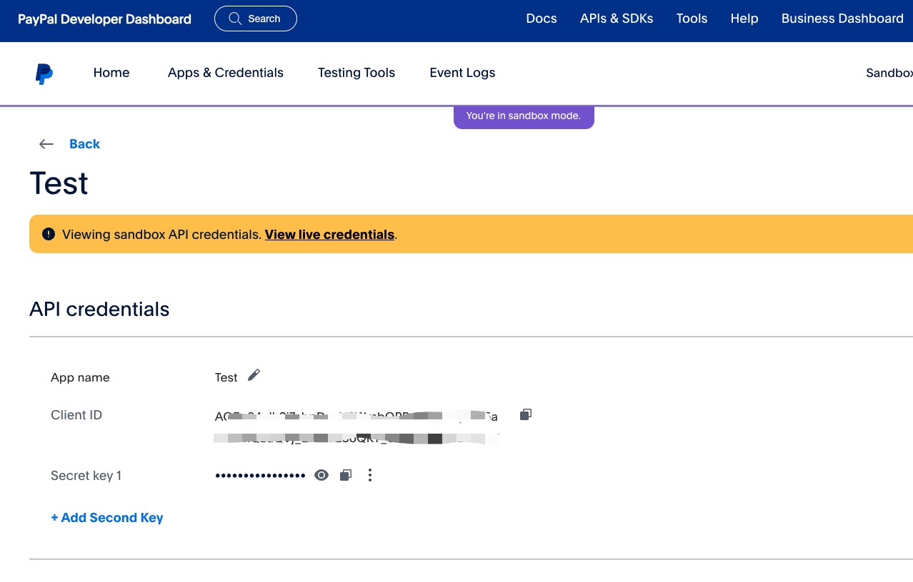

在图床后台创建 PayPal 驱动，填写：

| 字段 | 说明 |
|---|---|
| 模式 | 正常模式或沙箱模式，与 PayPal 应用所在的环境一致 |
| Client ID、Client Secret | 应用的 Client ID 和 Secret |
| 货币代码 | 收款货币，默认 `USD`，见 [PayPal 货币代码](https://developer.paypal.com/api/rest/reference/currency-codes) |
| 汇率 | 见[汇率](#exchange-rate) |
| Webhook ID | 见下一节 |

### Webhook {#paypal-webhook}

「Webhook ID」是必填项，而 Webhook 地址要保存驱动后才显示，因此首次创建时先随意填写一个临时值保存（此时先不要在角色组中启用这个驱动），再复制编辑页中显示的「Webhook 地址」。然后在 PayPal 应用详情的底部找到 Webhooks，添加 Webhook：

- **Webhook URL**：填写复制的 Webhook 地址
- **事件**：订阅 `CHECKOUT.ORDER.APPROVED` 和 `PAYMENT.CAPTURE.COMPLETED`

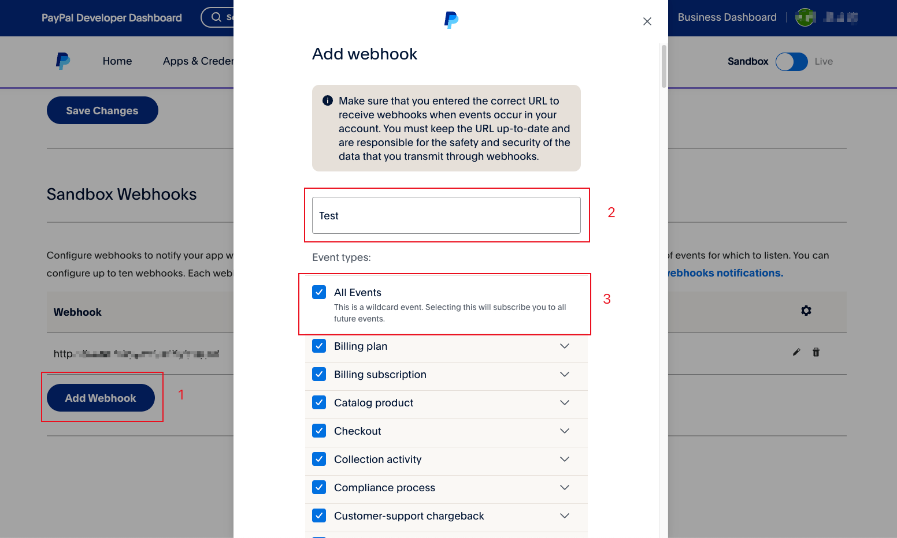

创建后，列表中会显示 Webhook ID，用它替换图床后台「Webhook ID」中的临时值并保存。

## EPay {#epay}

对接兼容易支付接口的聚合支付平台。需要填写：

| 字段 | 说明 |
|---|---|
| 支付接口地址 | 平台提供的接口地址 |
| 商户 ID | 平台分配的商户 ID |
| API 版本 | V2 新版本使用 RSA 签名，填写平台公钥和商户私钥；V1 旧版本使用 MD5 签名，填写 MD5 密钥 |
| 成功状态码 | 平台接口返回成功时的状态码，默认 `0`，部分修改版平台为 `1` |
| 支付通道 | 勾选平台支持并要提供给用户的通道，例如支付宝、微信、QQ 钱包 |

## Stripe {#stripe}

使用 Stripe 托管的支付页面收款，支持银行卡、Apple Pay、Google Pay 等，具体可用的支付方式在 Stripe 后台设置。

1. 在 Stripe 后台的「开发者」→「API 密钥」中复制 Secret Key（`sk_live_` 或 `sk_test_` 开头，也可以使用 `rk_` 开头的受限密钥）
2. 在图床后台创建 Stripe 驱动，填写 Secret Key、货币代码（默认 `usd`，见 [Stripe 支持的货币](https://docs.stripe.com/currencies)）和[汇率](#exchange-rate)。「Webhook 签名密钥」是必填项，先随意填写一个临时值保存（此时先不要在角色组中启用这个驱动）
3. 复制编辑页中显示的「Webhook 地址」，在 Stripe 后台的「开发者」→「Webhook」中添加端点，监听 `checkout.session.completed` 和 `checkout.session.async_payment_succeeded` 两个事件
4. 创建端点后，复制 `whsec_` 开头的签名密钥，替换图床后台「Webhook 签名密钥」中的临时值并保存

用户重复发起支付时，程序会复用未过期的支付页面；订单取消、修改金额或已经付款后，程序会关闭仍可付款的支付页面，避免重复付款。

## 汇率 {#exchange-rate}

系统中的金额以人民币计价。PayPal 和 Stripe 用其他货币收款时，需要设置「汇率」：付款金额 = 系统金额 × 汇率。例如人民币兑美元约为 `0.14`，设为 `1` 表示不转换。汇率不会自动更新，请定期检查。
