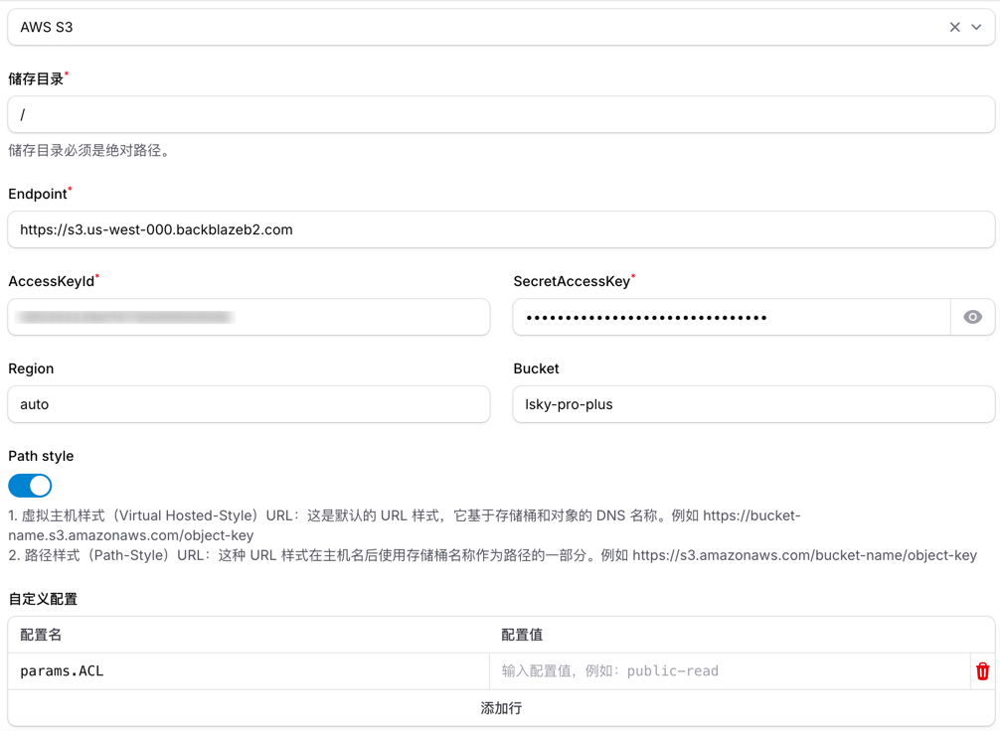

# 储存 {#storage}

储存决定上传的图片保存在哪里、以什么地址访问。系统中可以创建多个储存，每个储存选择一种驱动，再通过[角色组](./group#storage)分配给用户。

在管理后台的「储存管理」页面，点击「新建」按钮即可创建储存。表单分为「通用」「配置」「处理器」三个标签页。

## 支持的储存 {#drivers}

目前支持 10 种驱动：本地、AWS S3、阿里云 OSS、腾讯云 COS、七牛云 Kodo、又拍云 USS、多吉云、Sftp、Ftp、Webdav。其中：

- **本地**：保存在程序所在服务器的目录中
- **AWS S3**：Amazon S3，以及兼容 S3 接口的储存，见[兼容 S3 的储存](#s3-compatible)
- **七牛云 Kodo**：需要填写绑定的域名，否则无法使用云处理
- **多吉云**：填写 Access Key、Secret Key 和 Bucket 名称，程序自动获取临时密钥

不支持自行添加驱动。需要其他储存时，可以先看它是否兼容 S3、WebDAV、SFTP 或 FTP 协议，兼容的可以用对应驱动接入；也可以到[论坛](https://bbs.lskypro.com)提出需求。

### 兼容 S3 的储存 {#s3-compatible}

MinIO、Backblaze B2 等兼容 S3 接口的储存，选择「AWS S3」驱动接入，填写服务商提供的 Endpoint、Region、Bucket 和密钥即可。自建的 MinIO 等服务通常需要打开「Path style」。

AWS S3 驱动的「自定义配置」用于传入额外的参数，配置名用 `.` 表示层级。例如配置名 `params.ACL` 表示上传时的 ACL 参数：

- **不添加**：上传的文件设置为私有（`private`）。储存桶通过桶策略设为公开读取、或通过 CDN 回源访问时，可以正常访问
- **配置值填 `public-read`**：上传的文件设置为公开读。储存桶依靠文件的 ACL 公开访问时需要添加，否则图片链接会返回 403
- **配置值留空**：上传时发送空的 ACL，适合不支持 ACL 的储存，例如 [Backblaze B2](#how-to-connect-backblaze-b2)

## 储存是如何运作的 {#how-storage-works}

「通用」标签页中的主要字段：

| 字段 | 说明 |
|---|---|
| 访问 URL | 图片链接的域名部分，例如 `https://img.example.com`。对象储存通常填写绑定的 CDN 域名 |
| 命名规则 | 文件保存的路径和名称，见[支持的文件命名规则](#nameing-rules) |
| 访问前缀 | 拼接在访问 URL 后面的一级目录，见[访问前缀是什么](#what-is-the-prefix) |
| 访问后缀 | 返回图片链接时拼接在末尾的内容，例如云处理参数 `?p=small` |
| 生成缩略图 | 是否为上传的图片生成缩略图，见[缩略图](#thumbnail) |

图片链接由「访问 URL / 访问前缀 / 文件路径 访问后缀」组成，例如 `https://img.example.com/uploads/20260101/xxx.jpg`。

「配置」标签页中填写驱动的连接信息和「储存目录」。储存目录必须是绝对路径：

- **本地储存**：可以是服务器上的任意目录，例如单独挂载的数据盘 `/mnt/data/photos`。请确保 Web 服务器和队列的运行用户对该目录有写入权限，否则上传会失败
- **其他储存**：填写储存桶或服务器中的目录，默认 `/` 表示根目录

创建或编辑本地储存时，程序会自动创建储存目录（不存在时），并在 `public` 目录中创建一个以访问前缀命名的符号链接，指向储存目录，见[访问前缀是什么](#what-is-the-prefix)。

## 访问前缀是什么 {#what-is-the-prefix}

访问前缀是本地储存在 `public` 目录中的符号链接的名称，默认为 `uploads`。这样图片可以保存在 `public` 目录以外，仍然能通过网址访问。假设站点运行目录为 `/www/app/public`，本地储存的储存目录为 `/mnt/data/photos`，访问前缀为 `uploads`：

- 程序创建符号链接 `/www/app/public/uploads`，指向 `/mnt/data/photos`
- 访问 `https://example.com/uploads/test.png` 时，实际读取的是 `/mnt/data/photos/test.png`

开启云处理的储存不再使用符号链接，所有图片请求都交给程序处理，程序通过访问前缀找到对应的储存和云处理配置。

因此，本地储存和开启了云处理的储存必须填写访问前缀，其他储存可以留空。访问前缀只能包含字母、数字、`-` 和 `_`，不能与其他储存重复，也不能与 `public` 目录中已有的目录同名。

:::tip
符号链接丢失（例如迁移服务器后）时，可以执行 `php artisan symlinks:rebuild` 重新创建，见[常用命令](../advanced/command#gen-app-symlink)。
:::

## 处理器是什么 {#what-is-the-processor}

「处理器」标签页中，每个储存可以分别关联一个图片安全驱动、图片处理驱动和云处理驱动，上传到该储存的图片会按这些驱动处理：

- **图片安全驱动**：上传后审核图片是否违规，可以使用第三方审核服务或 [AI 大模型审核](./ai#moderation)
- **图片处理驱动**：上传后修改原图，例如裁剪、缩放、添加水印、转换格式，见[图片处理](./handle)
- **云处理驱动**：访问图片时通过网址参数实时生成不同尺寸和样式的图片，原图不变，见[云处理](./process)

:::warning
开启云处理后，图片请求由程序处理，请把「访问 URL」填写为程序的域名（或指向程序的 CDN 域名），否则云处理参数不会生效。
:::

## 缩略图 {#thumbnail}

「生成缩略图」默认开启，程序在上传后生成缩略图，用于图片列表和广场。可以设置「缩略图最大尺寸」（默认 800 像素）和「缩略图质量」（默认 90）。图片的宽和高都超过最大尺寸时才会缩小。

缩略图统一保存在程序的 `storage/app/public/thumbnails` 目录中，不占用储存的空间。关闭期间上传的图片没有缩略图，重新开启后可以执行 `php artisan app:thumbnail` 补生成，见[常用命令](../advanced/command#gen-thumbnails)。

## 支持的文件命名规则 {#nameing-rules}

命名规则决定文件保存的路径和名称，用 `/` 分隔目录，默认为 `{Ymd}/{md5}`。文件扩展名由程序自动加上，规则中不需要写 `.{ext}`。

| 变量 | 示例值 | 说明 |
|---|---|---|
| `{Y}` | 2026 | 年份 |
| `{y}` | 26 | 年份后两位 |
| `{m}` | 01 | 月份 |
| `{d}` | 04 | 日期 |
| `{Ymd}` | 20260104 | 年月日 |
| `{filename}` | photo | 原文件名（不含扩展名） |
| `{ext}` | png | 原文件扩展名 |
| `{time}` | 1767484800 | 时间戳 |
| `{uniqid}` | 667530e55196f | 唯一 ID |
| `{md5}` | e10adc3949ba59abbe56e057f20f883e | 文件的 MD5 值 |
| `{sha1}` | 7c4a8d09ca3762af61e59520943dc26494f8941b | 文件的 SHA1 值 |
| `{uuid}` | ca083d36-1f0a-4d2a-83f7-f3e97f4f4bfa | UUID |
| `{uid}` | 1 | 用户 ID，游客为 0 |

## 重复上传 {#duplicate-upload}

程序不会拒绝重复上传，是否保存新文件取决于命名规则生成的路径：

- **路径已存在**：不再写入文件，复用已有的文件。同一个用户在同一个储存中重复上传内容相同（MD5 和 SHA1 都相同）的图片时，沿用原来的图片记录，图片管理中不会多出一张；其他情况各自新建图片记录，共用同一个文件
- **路径不同**：保存为新的文件和新的图片。规则中有 `{uuid}` 或 `{uniqid}` 时每次路径都不同；`{time}` 精确到秒，同一秒内上传的文件路径可能相同；默认规则 `{Ymd}/{md5}` 下，同一张图片在不同日期上传也会保存为新文件

储存关联了图片处理驱动时，处理结果会改写文件，所以这类图片不与其他用户的图片共用文件：异步处理的图片上传时就保存到独立的路径；同步处理时遇到共用的文件，处理后也会改用独立的路径。

多张图片共用一个文件时，删除其中一张不会删除文件，直到没有图片使用它。

## 如何连接 Backblaze B2？ {#how-to-connect-backblaze-b2}

创建储存时选择「AWS S3」驱动，`Region` 填写 `auto`，在「自定义配置」中添加配置名 `params.ACL`、配置值留空（见[兼容 S3 的储存](#s3-compatible)）。如果连接失败，可以把 `Region` 改为 Endpoint 中的地域，例如 `us-west-004`。

:::warning
Backblaze B2 的 Bucket 默认保留文件的历史版本，在图床后台删除图片后，B2 控制台中仍然能看到文件，这是正常现象。可以在 B2 的 Bucket 设置中调整生命周期规则，自动清除旧版本。
:::
